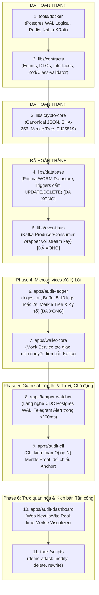

# 🗺️ AegisLedger - Lộ Trình & Thứ Tự Triển Khai Hệ Thống (Architecture Roadmap)

> **Dự án:** AegisLedger - Autonomous Cryptographic Audit Trail & Tamper-Detection Engine  
> **Kiến trúc:** Nx Monorepo, Event-Driven Architecture, Applied Cryptography & Database CDC  
> **Tài liệu:** Kim chỉ nam quy định thứ tự ưu tiên triển khai từng thành phần (Phase-by-Phase Execution Plan).

---

## 🧭 1. Triết Lý Thiết Kế & Nguyên Tắc Xác Định Thứ Tự Ưu Tiên

Trong kiến trúc **Nx Monorepo** và **Distributed Systems**, thứ tự xây dựng các thành phần **bắt buộc** phải tuân theo nguyên lý:
> **"Bottom-Up & Dependency-Inversion" (Từ gốc rễ phụ thuộc thấp nhất đi lên)**

1. **Hạ tầng trước (Docker / Storage / Message Broker):** Không thể viết và test code database/Kafka nếu container chưa có sẵn.
2. **Hợp đồng dữ liệu (Contracts) làm nền móng:** Định nghĩa chuẩn giao tiếp trước để mọi service nói chung một ngôn ngữ, tránh sai lệch mã băm mật mã.
3. **Thư viện lõi (Core Libraries) độc lập:** Thư viện mật mã toán học và truy cập database phải hoàn chỉnh 100% trước khi ghép vào ứng dụng.
4. **Ứng dụng nghiệp vụ (Microservices):** Xây dựng theo đúng chiều chảy của dòng dữ liệu (*Ingestion $\rightarrow$ Batching/Signing $\rightarrow$ Storage $\rightarrow$ Real-time Watcher $\rightarrow$ Visual Dashboard*).
5. **Kịch bản tấn công (Attack Scripts & CLI):** Thực hiện sau cùng để kiểm chứng năng lực tự vệ của toàn bộ hệ thống.

---

## 📊 2. Sơ Đồ Tổng Quan Thứ Tự Triển Khai (Phase Workflow)

---

## 🔍 3. Chi Tiết Từng Bước (Steps), Lý Do "Vì Sao" & Tiêu Chí Nghiệm Thu (Acceptance Criteria)

---

### ✅ BƯỚC 1: `tools/docker` (Hạ tầng Ảo hóa) - [ĐÃ XONG]
* **Mục đích:** Cung cấp môi trường chạy cơ sở dữ liệu và message broker tại local.
* **Vì sao làm trước:** Nếu không có PostgreSQL hỗ trợ `wal_level=logical` và Kafka, các service phía sau không thể chạy hay kiểm thử tích hợp (Integration Test).
* **Thành phần:**
  * `docker-compose.postgres.yml`: Postgres 16 cấu hình Logical Replication cho CDC.
  * `docker-compose.redis.yml`: Redis cache & cờ Active Defense (`LOCK_WITHDRAWALS`).
  * `docker-compose.kafka.yml`: Kafka 3.7 KRaft mode (siêu nhẹ, không cần Zookeeper).
  * `docker-compose.yml`: File master include 3 file trên.

---

### ✅ BƯỚC 2: `libs/contracts` (Giao ước Dữ liệu & Single Source of Truth) - [ĐÃ XONG]
* **Mục đích:** Định nghĩa Enums, TypeScript Interfaces và Class DTOs có Decorators (`class-validator`).
* **Vì sao làm trước:** 
  * Cả 5 service (`wallet-core`, `audit-ledger`, `tamper-watcher`, `audit-cli`, `audit-dashboard`) đều phụ thuộc vào schema này.
  * Đảm bảo tính nhất quán của dữ liệu đầu vào. Chỉ cần lệch kiểu dữ liệu hoặc thứ tự trường, mã băm SHA-256 sẽ sai khác và làm sụp đổ toàn bộ cây Merkle.
* **Tiêu chí nghiệm thu:** Unit test kiểm tra validation DTOs đạt 100% (5/5 passed).

---

### ✅ BƯỚC 3: `libs/crypto-core` (Trái tim Mật mã học) - [ĐÃ XONG]
* **Mục đích:** Xây dựng toàn bộ thuật toán toán học mật mã độc lập với framework.
* **Vì sao làm ở bước này:**
  * Đây là **"vũ khí cốt lõi"** chứng minh năng lực Security Engineering.
  * Không phụ thuộc vào Database hay Kafka. Chỉ thuần túy là thuật toán Node.js `crypto` và logic dựng cây.
  * Có thể viết Unit Test kiểm thử toán học 100% trước khi nối vào app.
* **Các module cần xây dựng:**
  1. `canonical-json`: Thuật toán chuẩn hóa chuỗi JSON (sắp xếp key alphabet, tránh lỗi nhảy key trong JS).
  2. `hasher`: SHA-256 Hasher chuẩn RFC 6234.
  3. `merkle-tree`:
     * Dựng cây nhị phân Bottom-Up từ danh sách lá (`leafHashes`).
     * Tự động nhân đôi lá lẻ khi số lượng lá không chia hết cho 2.
     * Hàm lấy `getRoot()`.
     * Hàm sinh đường dẫn chứng minh `getProof(index)` độ phức tạp $O(\log N)$.
     * Hàm kiểm tra độc lập `verifyProof(leafHash, proof, expectedRoot)`.
  4. `signer-ed25519`:
     * Sinh cặp khóa Ed25519 (`private_key.pem`, `public_key.pem`).
     * Ký số lên Merkle Root: `signRoot(root, privateKey)`.
     * Xác minh chữ ký: `verifySignature(root, signature, publicKey)`.
* **Tiêu chí nghiệm thu:** Bộ Unit Test Jest với 100% coverage cho Merkle Tree & Ed25519 signing.

---

### ✅ BƯỚC 4: `libs/database` (Kho Lưu Trữ WORM & Prisma Schema) - [ĐÃ XONG]
* **Mục đích:** Cung cấp tầng truy cập dữ liệu trực quan bằng Prisma ORM cho PostgreSQL kết hợp WORM Security Rules.
* **Vì sao làm ở bước này:**
  * `audit-ledger` cần schema bảng để lưu log; `tamper-watcher` cần schema để parse CDC; `audit-cli` cần schema để đọc dữ liệu kiểm toán.
* **Các module đã xây dựng:**
  1. Định nghĩa Prisma Schema cho 3 bảng:
     * `audit_logs` (Lá Merkle - Append-Only).
     * `epoch_blocks` (Khối Epoch chứa Root và Chữ ký số Ed25519).
     * `external_anchors` (Mốc neo kiểm toán ngoại vi).
  2. **WORM Security Rules & CDC:**
     * Viết Trigger PL/pgSQL chặn cứng quyền `UPDATE` và `DELETE` trên bảng `audit_logs` ngay tại tầng nhân DB (mã lỗi `55000`).
     * Trigger bảo vệ tính bất biến của các trường mật mã trên `epoch_blocks` (`merkle_root`, `signature`...).
     * Trigger cấm UPDATE và DELETE trên `external_anchors` bảo vệ mốc neo ngoại vi.
     * Kích hoạt `REPLICA IDENTITY FULL` cho PostgreSQL CDC.
     * Cung cấp `EpochBatchService` thực thi Atomic Transaction cho Epoch chốt sổ.
* **Tiêu chí nghiệm thu:** Bộ Unit/Integration Test Jest chạy trên PostgreSQL container đạt **100% (13/13 passed)**; thử chạy lệnh SQL `UPDATE` / `DELETE` bị database từ chối ngay lập tức.

---

### ✅ BƯỚC 5: `libs/event-bus` (Hạ tầng Giao tiếp Message Stream) - [ĐÃ XONG]
* **Mục đích:** Đóng gói thư viện Kafka Client (KafkaJS) chuẩn hóa.
* **Vì sao làm ở bước này:** Tránh việc mỗi app phải tự cấu hình Kafka producer/consumer lặp đi lặp lại.
* **Các module đã xây dựng:**
  * `KafkaProducerService`: Bắn sự kiện `AuditEvent` vào topic kèm `streamKey` (ví dụ `walletId`) để phân chia partition, hỗ trợ Idempotent Producer và Distributed Tracing headers.
  * `KafkaConsumerService`: Consumer wrapper hỗ trợ tự động deserialize và validate bằng DTO của `libs/contracts`, cơ chế Poison Pill Protection chuyển hướng sang Dead Letter Queue (`.dlq`).
  * `EventBusModule`: Dynamic Module NestJS hỗ trợ `forRoot()` và `forRootAsync()`.
* **Tiêu chí nghiệm thu:** Bộ Unit Test Jest với **100% coverage (8/8 tests passed)** kiểm thử thành công Producer, Consumer DTO validation, DLQ routing và Dynamic Module.

---

### ✅ BƯỚC 6: `apps/audit-ledger` (Microservice Xử lý Ingestion & Epoch Engine) - [ĐÃ XONG]
* **Mục đích:** Trọng tâm xử lý của toàn bộ hệ sinh thái AegisLedger.
* **Vì sao làm ở bước này:** Sau khi đã có `libs/crypto-core`, `libs/database`, `libs/event-bus`, ta ghép chúng lại thành Ingestion Pipeline.
* **Các module đã xây dựng:**
  * `inbound/`: `AuditEventConsumer` lắng nghe Kafka topic `audit.events`, validate schema `AuditEventDto`, cách ly poison pills vào DLQ.
  * `buffer/`: `SlidingWindowService` với cơ chế Dual-Trigger (ngưỡng dung lượng 5-10 logs hoặc timeout 2s), `BufferMutex` chống race-condition.
  * `engine/`: `EpochEngineService` tính toán Leaf Hashes (SHA-256 kèm domain separation `0x00`), dựng Merkle Tree nhị phân, ký số Ed25519; `SequenceTrackerService` đảm bảo sequence tăng dần liên tục ($1, 2, 3 \dots$).
  * `keys/`: `ValidatorKeyProvider` quản lý cặp khóa Ed25519 và sinh raw hex 64 ký tự tương thích cột `signer_public_key`.
  * `outbound/`: `EpochPersistenceService` gọi `EpochBatchService` commit nguyên tử mảng logs và epoch block vào PostgreSQL WORM; `EpochBroadcasterService` phát sự kiện real-time.
  * `main.ts`: Bootstrap NestJS Application Context kèm hook Graceful Shutdown bảo toàn 100% dữ liệu trong buffer khi tắt service.
* **Tiêu chí nghiệm thu:** Toàn bộ 3 test suites với **100% tests passed (9/9 passed)** gồm Unit test Buffer, Unit test Epoch Engine, và E2E Integration test trên PostgreSQL container thực tế.

---

### ✅ BƯỚC 7: `apps/wallet-core` (Microservice Nghiệp vụ Giả lập & Active Defense) - [ĐÃ XONG]
* **Mục đích:** Mô phỏng ứng dụng tài chính thực tế để phát sinh giao dịch, đồng thời là điểm thực thi cơ chế tự vệ chủ động (Active Defense).
* **Vì sao làm ở bước này:** Khi `audit-ledger` đã sẵn sàng đón nhận dữ liệu, `wallet-core` sẽ là nguồn phát sinh dữ liệu thử nghiệm, đồng thời kiểm chứng khả năng đóng băng giao dịch rút tiền khi hệ thống bị tấn công.
* **Các module đã xây dựng:**
  * `config/`: Quản lý cấu hình Kafka, Redis (`AEGIS:ACTIVE_DEFENSE:LOCK_WITHDRAWALS`), HTTP Port thông qua `WalletConfigService`.
  * `defense/`:
    * `RedisDefenseService`: Kết nối Redis kiểm tra và cập nhật cờ tự vệ chủ động.
    * `ActiveDefenseGuard`: Intercept các endpoint nguy hiểm, quăng ngoại lệ **HTTP 423 Locked** khi cờ tự vệ được kích hoạt.
  * `common/`: Decorator `@ClientInfo()` trích xuất IP, User-Agent, Device-Id từ HTTP Request Headers.
  * `auth/`:
    * `POST /auth/login`: Xác thực tài khoản, bắn sự kiện `USER_LOGIN_SUCCESS` hoặc `USER_LOGIN_FAILED` vào Kafka.
    * `POST /auth/logout`: Đăng xuất, bắn sự kiện `USER_LOGOUT` vào Kafka.
  * `wallets/`:
    * `WalletStore`: Lưu trữ in-memory trạng thái ví và lịch sử giao dịch (seed sẵn ví `wal_alice_usd` và `wal_bob_usd`).
    * `POST /wallets`: Khởi tạo ví mới.
    * `GET /wallets/:id`: Tra cứu thông tin và số dư ví.
    * `POST /wallets/deposit`: Nạp tiền, tăng số dư, phát sự kiện `WALLET_DEPOSIT`.
    * `POST /wallets/withdraw`: Rút tiền, bảo vệ bởi `ActiveDefenseGuard`, phát sự kiện `WALLET_WITHDRAW`.
    * `POST /wallets/transfer`: Chuyển khoản nội bộ giữa 2 ví, bảo vệ bởi `ActiveDefenseGuard`, phát sự kiện `WALLET_TRANSFER`.
    * `GET /wallets/:id/history`: Tra cứu lịch sử biến động số dư.
  * `main.ts` & `app.module.ts`: Khởi động NestJS Express Server với `ValidationPipe` toàn cục.
* **Tiêu chí nghiệm thu:** Bộ Unit và E2E Integration tests đạt **100% (25/25 tests passed)**, xác minh chặn đứng giao dịch khi có cờ đỏ Redis và thông suốt khi hệ thống an toàn.

---

### ✅ BƯỚC 8: `apps/tamper-watcher` (Autonomous Active Defense qua Postgres CDC) - [ĐÃ XONG]
* **Mục đích:** Giám sát thời gian thực, phát hiện xâm nhập và tự vệ trong `< 200ms`.
* **Vì sao làm ở bước này:** Khi dữ liệu đang được ghi nhận vào PostgreSQL, Watcher sử dụng luồng WAL để giám sát tính toàn vẹn ngay ở tầng sâu nhất.
* **Các module đã xây dựng:**
  * `config/`: Quản lý cấu hình Postgres, Redis, Kafka, Telegram Bot Token/Chat ID.
  * `defense/`: `ActiveDefenseService` kích hoạt cờ đỏ `AEGIS:ACTIVE_DEFENSE:LOCK_WITHDRAWALS=true` với độ trễ đo lường thực tế $< 1\text{ms}$.
  * `alert/`:
    * `TelegramService`: Định dạng HTML gửi tin SOS tới Telegram Bot, tích hợp cơ chế Console Fallback Mode tự động khi chưa có token.
    * `AlertDispatcherService`: Điều phối kích hoạt khóa Redis $\rightarrow$ Bắn Kafka `aegis.tamper.alerts` $\rightarrow$ Bắn tin Telegram.
  * `cdc/`:
    * `CdcEventParser`: Bóc tách cú pháp WAL của plugin `test_decoding` (phân loại INSERT, UPDATE, DELETE).
    * `CdcListenerService`: Quản lý logical replication slot `aegis_tamper_watcher_slot`, bắt quả tang mọi lệnh UPDATE/DELETE trên các bảng WORM.
  * `scanner/`:
    * `IntegrityScannerService`: Quét chu kỳ kiểm tra tính liên tục của sequence (phát hiện `SEQUENCE_GAP`), kiểm tra Hash Chain (`HISTORICAL_REWRITE`) và chữ ký số Ed25519 (`SIGNATURE_FORGERY`).
* **Tiêu chí nghiệm thu:** Bộ Unit và E2E Integration tests đạt **100% (16/16 tests passed)**, thời gian kích hoạt tự vệ từ khi phát hiện breach đạt chuẩn SLA $< 200\text{ms}$ (thực tế $< 1\text{ms}$).

---

### ✅ BƯỚC 9: `apps/audit-cli` (Công cụ Kiểm toán Độc lập Zero-Trust) - [ĐÃ XONG]
* **Mục đích:** Công cụ dòng lệnh dành cho kiểm toán viên bên thứ ba hoặc người dùng tự xác minh tính toàn vẹn.
* **Vì sao làm ở bước này:** Sau khi đã có cơ sở dữ liệu sổ cái và hệ thống phòng vệ, CLI cung cấp cơ chế kiểm toán ngoại tuyến và sinh bằng chứng chứng minh giao dịch.
* **Các lệnh và module đã xây dựng:**
  * `services/chain-verifier.service.ts`: Quét toàn diện tính toàn vẹn chuỗi: sequence continuity ($1..N$), hash chain link giữa các Epoch, xác minh chữ ký số Ed25519 của Validator và tái dựng Cây Merkle đối chiếu Merkle Root.
  * `services/merkle-prover.service.ts`: Trích xuất đường dẫn bằng chứng thành viên Merkle Proof $O(\log N)$ cho một giao dịch theo sequence number.
  * `services/proof-verifier.service.ts`: Xác minh toán học độc lập bằng chứng Merkle Proof ngoại tuyến (Offline Zero-Trust) mà không cần kết nối mạng hay database.
  * `commands/`: Triển khai 3 lệnh CLI: `verify`, `prove --seq <number> [--out <file>]`, và `verify-proof --file <file>`.
* **Tiêu chí nghiệm thu:** Bộ Unit tests đạt **100% (11/11 tests passed)**, các lệnh CLI hoạt động chuẩn xác với exit code 0 khi toàn vẹn và exit code 1 khi có dấu hiệu gian lận.

---

### ✅ BƯỚC 10: `apps/audit-dashboard` (Giao diện Web Trực quan Real-time) - [ĐÃ XONG]
* **Mục đích:** Cung cấp bảng điều khiển trung tâm (SOC) trực quan hóa cấu trúc mật mã Merkle Tree, Hash Chain và hệ thống phòng thủ chủ động Active Defense theo thời gian thực.
* **Vì sao làm ở bước này:** Khi toàn bộ microservices lõi đã vận hành, dashboard mang lại trải nghiệm thị giác ấn tượng, phục vụ demo showcase và trực ban an ninh SOC.
* **Các module đã xây dựng:**
  * `src/api/`:
    * `SseService`: RxJS Subject stream dữ liệu Server-Sent Events đa kênh theo thời gian thực.
    * `DashboardService`: Tính toán số liệu tổng quan (Overview), trích xuất danh sách Epoch, tái dựng cây Merkle theo từng tầng (Layers & Nodes) để vẽ trên canvas/SVG, sinh & xác minh Merkle Sibling Proof trực tuyến, quản lý cờ đỏ tự vệ và nút Reset.
    * `DashboardController`: Cung cấp bộ REST API chuẩn (`/api/overview`, `/api/epochs`, `/api/epochs/:epochNumber/tree`, `/api/proof/:sequence`, `/api/security/status`, `/api/security/reset`, `/api/stream`).
  * `src/public/`:
    * Giao diện HTML5/CSS3 chuẩn phong cách Dark Cyberpunk / Glassmorphism hiện đại.
    * Trình diễn cây Merkle dạng tương tác đồ họa véc-tơ SVG mềm mại với đường cong cubic Bézier.
    * Inspector Drawer: Xem chi tiết nội dung Audit Log từng lá cây khi nhấp chuột.
    * Proof Highlighting: Tô sáng đường dẫn xác minh Merkle Proof $O(\log N)$ trực tiếp trên cây nhị phân.
    * Live Security Siren: Hiệu ứng đèn cảnh báo đỏ chớp nháy toàn màn hình khi phát hiện vi phạm cơ sở dữ liệu và cờ đỏ Active Defense kích hoạt.
  * `main.ts` & `app.module.ts`: Khởi động ứng dụng phục vụ song song cả REST API lẫn Static Web UI tại cổng `3333`.
* **Tiêu chí nghiệm thu:** Bộ Unit tests đạt **100% (14/14 tests passed)**, giao diện Web phản hồi tức thì với SSE stream và tương tác đồ họa cây Merkle mượt mà.

---

### ⏳ BƯỚC 11: `tools/scripts` (Bộ Kịch bản Tấn công Demo Showcase)
* **Mục đích:** Bộ script chuẩn bị sẵn cho buổi phỏng vấn hoặc quay video demo kỹ thuật.
* **Các kịch bản:**
  * `demo-attack-modify.sh`: Hacker chạy lệnh SQL sửa số tiền ở Block cũ $\rightarrow$ Watcher bắt trong < 200ms qua CDC $\rightarrow$ Telegram SOS $\rightarrow$ Redis locked $\rightarrow$ Wallet 423.
  * `demo-attack-delete.sh`: Hacker chạy SQL xóa 1 dòng log $\rightarrow$ Watcher/CLI báo gãy chuỗi sequence `SEQUENCE_GAP`.
  * `demo-attack-rewrite.sh`: Hacker sửa data và tự tính lại Root nội bộ $\rightarrow$ Bị bắt quả tang khi đối chiếu với External Anchor và chữ ký số Ed25519.

---

## 📌 Bảng Tóm Tắt Trạng Thái & Kế Hoạch Tiếp Theo

| Bước | Thành phần | Trạng thái | Nhiệm vụ chính |
| :---: | :--- | :---: | :--- |
| **1** | `tools/docker` | ✅ **Hoàn thành** | Postgres WAL logical, Redis, Kafka KRaft |
| **2** | `libs/contracts` | ✅ **Hoàn thành** | Enums, DTOs (`class-validator`), Interfaces, Unit tests passed |
| **3** | `libs/crypto-core` | ✅ **Hoàn thành** | Canonical JSON, SHA-256, Merkle Tree $O(\log N)$, Ed25519 Signing (24/24 tests passed) |
| **4** | `libs/database` | ✅ **Hoàn thành** | Prisma WORM Datastore, PostgreSQL Triggers chặn UPDATE/DELETE trên cả 3 bảng (13/13 tests passed) |
| **5** | `libs/event-bus` | ✅ **Hoàn thành** | Kafka Producer/Consumer wrappers, DTO auto-validation, DLQ routing (8/8 tests passed) |
| **6** | `apps/audit-ledger` | ✅ **Hoàn thành** | Ingestion pipeline, Dual-trigger Buffer (size/time), Merkle Tree, Ed25519, PostgreSQL WORM atomic commit (9/9 tests passed) |
| **7** | `apps/wallet-core` | ✅ **Hoàn thành** | Mock API nạp/chuyển tiền bắn Kafka, Active Defense 423 Locked (25/25 tests passed) |
| **8** | `apps/tamper-watcher`| ✅ **Hoàn thành** | CDC Logical Replication, Telegram Alert, Active Defense (16/16 tests passed) |
| **9** | `apps/audit-cli` | ✅ **Hoàn thành** | CLI verify chuỗi, xuất và xác minh Merkle Proof O(log N) (11/11 tests passed) |
| **10**| `apps/audit-dashboard`| ✅ **Hoàn thành** | Web giao diện cây Merkle real-time, Siren báo động, REST API (14/14 tests passed) |
| **11**| `tools/scripts` | 🎯 **Ưu tiên tiếp theo** | 3 kịch bản demo tấn công |

---

*Tài liệu này là kim chỉ nam chính thức điều hướng toàn bộ quá trình phát triển của dự án AegisLedger.*
