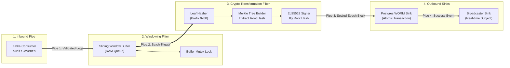

# 🛡️ AegisLedger - Ingestion & Epoch Engine (`apps/audit-ledger`)

> **Vai trò:** Trái tim xử lý dữ liệu kiểm toán (The Cryptographic Scribe / Notary Daemon).  
> **Kiến trúc nội bộ:** Pipes & Filters kết hợp Hexagonal Architecture (Ports & Adapters).  
> **Trạng thái:** ✅ Đã hoàn thành 100% (9/9 tests passed, 59/59 workspace tests passed).

---

## 📑 MỤC LỤC CHI TIẾT
1. [Tổng Quan & Sơ Đồ Luồng Dữ Liệu (Pipes & Filters)](#1-tổng-quan--sơ-đồ-luồng-dữ-liệu)
2. [Bản Đồ Cấu Trúc Thư Mục (Folder Structure Map)](#2-bản-đồ-cấu-trúc-thư-mục)
3. [Đi Sâu Vào Chi Tiết Từng Folder & Từng File](#3-đi-sâu-vào-chi-tiết-từng-folder--từng-file)
   - [3.1. Thư mục `src/config/` (Cấu hình & Biến môi trường)](#31-thư-mục-srcconfig)
   - [3.2. Thư mục `src/inbound/` (Cổng tiếp nhận dữ liệu Kafka)](#32-thư-mục-srcinbound)
   - [3.3. Thư mục `src/buffer/` (Bộ đệm nhịp độ & Khóa tương tranh)](#33-thư-mục-srcbuffer)
   - [3.4. Thư mục `src/engine/` (Trái tim Mật mã & Theo dõi Thứ tự)](#34-thư-mục-srcengine)
   - [3.5. Thư mục `src/keys/` (Quản lý Khóa Ký Thẩm Quyền Ed25519)](#35-thư-mục-srckeys)
   - [3.6. Thư mục `src/outbound/` (Cổng xuất bản dữ liệu: DB WORM & Broadcaster)](#36-thư-mục-srcoutbound)
   - [3.7. File `src/main.ts` & `src/app.module.ts` (Entrypoint & Điều phối)](#37-file-srcmaints--srcappmodulets)
4. [Giải Mã Các Đoạn Code Quan Trọng & Triết Lý "Vì Sao Lại Làm Như Vậy?"](#4-giải-mã-các-đoạn-code-quan-trọng--vì-sao)
   - [Tại sao JavaScript Single-Threaded vẫn bị Race-Condition và cần Mutex?](#41-tại-sao-javascript-single-threaded-vẫn-bị-race-condition-và-cần-mutex)
   - [Tại sao phải thêm tiền tố `0x00` (Domain Separation) khi băm lá Merkle?](#42-tại-sao-phải-thêm-tiền-tố-0x00-domain-separation-khi-băm-lá-merkle)
   - [Bí mật ASN.1: Tại sao Public Key Ed25519 lại lưu vừa vặn `VARCHAR(64)` trong DB?](#43-bí-mật-asn1-tại-sao-public-key-ed25519-lưu-vừa-vặn-varchar64-trong-db)
   - [Tại sao phải tự quản lý Sequence thay vì dùng Database `SERIAL`?](#44-tại-sao-phải-tự-quản-lý-sequence-thay-vì-dùng-database-serial)
   - [Tại sao dùng `createApplicationContext` thay vì bật HTTP Server?](#45-tại-sao-dùng-createapplicationcontext-thay-vì-bật-http-server)
5. [Kiểm Thử & Tiêu Chí Nghiệm Thu (Test Suites)](#5-kiểm-thử--tiêu-chí-nghiệm-thu)

---

## 1. Tổng Quan & Sơ Đồ Luồng Dữ Liệu

Microservice `audit-ledger` hoạt động như một **nhà máy xử lý dòng dữ liệu liên tục**. Dữ liệu chảy một chiều (One-Way Pipeline) qua 4 chặng:



---

## 2. Bản Đồ Cấu Trúc Thư Mục

```text
apps/audit-ledger/
├── README.md                           # Tài liệu chi tiết này
├── project.json                        # Cấu hình Nx target (build, serve, lint, test)
├── tsconfig.json                       # Config TypeScript kế thừa từ tsconfig.base.json
├── tsconfig.app.json                   # Config build ứng dụng độc lập
├── jest.config.js                      # Cấu hình Jest runner cho app
│
├── src/
│   ├── main.ts                         # Điểm khởi chạy (Bootstrap & Graceful Shutdown)
│   ├── app.module.ts                   # Root Module liên kết các dependencies
│   │
│   ├── config/                         # [Infrastructure] Đóng gói biến môi trường
│   │   ├── ledger.config.ts            # Định nghĩa Interface & Default values
│   │   ├── ledger-config.service.ts    # Service cung cấp config Type-Safe
│   │   ├── config.module.ts            # NestJS Global Module cho config
│   │   └── index.ts
│   │
│   ├── inbound/                        # [Inbound Adapter - Đầu vào Pipe]
│   │   ├── audit-event.consumer.ts     # Lắng nghe Kafka, validate DTO, đẩy vào Buffer
│   │   ├── inbound.module.ts
│   │   └── index.ts
│   │
│   ├── buffer/                         # [Filter 1: Sliding Window Buffer]
│   │   ├── buffer-mutex.ts             # Khóa tương tranh Mutex cho hàm flush
│   │   ├── sliding-window.service.ts   # Bộ đệm kích hoạt kép (Size 5-10 hoặc Timeout 2s)
│   │   ├── buffer.module.ts
│   │   └── index.ts
│   │
│   ├── engine/                         # [Filter 2: Lõi Mật mã học Pure Domain]
│   │   ├── sequence-tracker.service.ts # Quản lý sequence và epochNumber liên tục
│   │   ├── epoch-engine.service.ts     # Băm lá, dựng Merkle Tree, ký số Ed25519
│   │   ├── engine.module.ts
│   │   └── index.ts
│   │
│   ├── keys/                           # [Security Domain: Khóa Validator]
│   │   ├── validator-key.provider.ts   # Nạp Private Key để ký, xuất Public Key 64 hex
│   │   ├── keys.module.ts
│   │   └── index.ts
│   │
│   └── outbound/                       # [Outbound Adapters - Đầu ra Pipe]
│       ├── persistence/                # Lưu trữ WORM bền vững
│       │   ├── epoch-persistence.service.ts # Gọi Atomic Transaction lưu DB
│       │   ├── persistence.module.ts
│       │   └── index.ts
│       ├── broadcaster/                # Phát tín hiệu ra ngoài
│       │   ├── epoch-broadcaster.service.ts # RxJS Subject phát event Epoch mới
│       │   ├── broadcaster.module.ts
│       │   └── index.ts
│       └── index.ts
│
└── test/                               # Bộ kiểm thử tự động
    ├── buffer.spec.ts                  # Unit test Sliding Window (Size, Time, Concurrency)
    ├── epoch-engine.spec.ts            # Unit test Merkle Tree, Ed25519 & Hash-chain
    └── audit-ledger.e2e-spec.ts        # E2E test: Ingestion -> DB WORM -> WORM Trigger Defense
```

---

## 3. Đi Sâu Vào Chi Tiết Từng Folder & Từng File

### 3.1. Thư mục `src/config/`
* **`ledger.config.ts`**:
  * Định nghĩa interface `ILedgerConfig` và đối tượng `DEFAULT_LEDGER_CONFIG`.
  * Thiết lập các tham số mặc định: `PORT: 3001`, `KAFKA_BROKERS: ['localhost:9092']`, `KAFKA_TOPIC: 'audit.events'`, `EPOCH_MAX_BATCH_SIZE: 10`, `EPOCH_MAX_WAIT_MS: 2000`.
* **`ledger-config.service.ts`**:
  * Đọc `process.env`, bóc tách chuỗi `KAFKA_BROKERS` thành mảng string, parse các số `batchSize` và `waitMs`.
  * **Tại sao làm vậy?** Không để code nghiệp vụ gọi trực tiếp `process.env.ABC` rải rác khắp nơi. Nếu biến môi trường bị rỗng hoặc truyền giá trị bậy (ví dụ `EPOCH_MAX_BATCH_SIZE=-5`), service tự động ép về giá trị mặc định hợp lệ, ngăn chặn crash lúc runtime.
* **`config.module.ts`**:
  * Đánh dấu `@Global()` để mọi module khác có thể inject `LedgerConfigService` mà không cần import đi import lại.

---

### 3.2. Thư mục `src/inbound/`
* **`audit-event.consumer.ts`**:
  * Triển khai lifecycle hook `OnModuleInit` của NestJS.
  * Gọi `KafkaConsumerService.subscribe<AuditEventDto>()` từ `@aegis/event-bus`.
  * Khi nhận được tin nhắn: kiểm tra tính hợp lệ của DTO. Nếu tin nhắn hợp lệ, gọi `this.slidingWindow.push(eventDto)`.
  * **Cơ chế chịu lỗi (Fault-Tolerance):** Nếu broker Kafka chưa bật hoặc đang kết nối lại, consumer bắt lỗi trong khối `try/catch` và log cảnh báo, không làm sập ứng dụng (cho phép app chạy ở chế độ Standalone/Offline).

---

### 3.3. Thư mục `src/buffer/`
* **`buffer-mutex.ts`**:
  * Cung cấp class `BufferMutex` với 2 phương thức: `acquire()` và `release()`.
  * Sử dụng hàng đợi các hàm resolve Promise (`waitQueue: Array<() => void>`).
  * **Tại sao cần file này?** Khi Timer 2 giây hết hạn đúng vào mili-giây mà bản ghi thứ 10 rơi vào hàng đợi, cả 2 trigger sẽ cùng gọi hàm `flush()`. Mutex đảm bảo chỉ có 1 tiến trình được phép cắt mảng log và thực thi chốt Epoch, tiến trình kia phải chờ và nhận thấy queue đã rỗng.
* **`sliding-window.service.ts`**:
  * Chứa mảng hàng đợi tạm thời trong RAM: `queue: IAuditEvent[] = []`.
  * Quản lý biến đếm thời gian: `timer: NodeJS.Timeout | null = null`.
  * **Luồng xử lý `push(event)`:**
    1. Đẩy event vào đuôi `queue`.
    2. Nếu `queue.length >= epochMaxBatchSize` $\rightarrow$ Hủy timer hiện tại và kích hoạt ngay lập tức `flush('THRESHOLD')`.
    3. Nếu chưa đủ kích thước và chưa có timer nào chạy $\rightarrow$ Bật timer đếm ngược 2000ms.
  * **Luồng xử lý `flush(reason)`:**
    1. Chờ lấy khóa Mutex: `await this.mutex.acquire()`.
    2. Cắt đúng `batchSize` phần tử đầu tiên bằng `this.queue.splice(0, batchSize)`.
    3. Giao mảng này cho `EpochEngineService.processBatch(batchItems)` xử lý.
    4. Nếu sau khi cắt mà trong `queue` vẫn còn log (do lượng traffic đổ về dồn dập) $\rightarrow$ Dùng `setImmediate()` để kích hoạt tiếp đợt flush sau mà không làm block event loop.
  * **Phương thức `forceFlush()`:** Dùng vòng lặp `while (this.queue.length > 0)` xả sạch toàn bộ log tồn đọng trước khi hệ thống tắt.

---

### 3.4. Thư mục `src/engine/`
* **`sequence-tracker.service.ts`**:
  * Quản lý 3 trạng thái bộ nhớ: `currentSequence` (số thứ tự log lớn nhất), `currentEpochNumber` (khối Epoch lớn nhất), và `currentPreviousRoot` (Root hash của khối trước).
  * Hàm `initialize()`: Chạy 1 lần duy nhất lúc khởi động, truy vấn DB lấy trạng thái mới nhất. Nếu DB trắng tinh, gán `currentPreviousRoot` bằng Genesis Hash (`0000...0000`).
  * Hàm `reserveNextBatch(count)`: Cấp phát trước dải sequence liên tục `[startSequence, endSequence]` cho lô log sắp xử lý.
  * Hàm `confirmBatchCommitted(...)`: Cập nhật trạng thái sau khi DB transaction thành công 100%.
* **`epoch-engine.service.ts`**:
  * Nhạc trưởng điều phối toán học:
    1. Duyệt qua mảng log, gán số `sequence` và tính toán `leafHash` cho từng dòng bằng hàm `hashLeaf()`.
    2. Gom toàn bộ `leafHash` đưa vào class `MerkleTree` để dựng cây nhị phân Bottom-Up và lấy về `merkleRoot`.
    3. Gọi `ValidatorKeyProvider.signEpoch()` để ký số Ed25519 lên phong bì Epoch (`epoch:N|root:HEX|prev:HEX`).
    4. Gọi `EpochPersistenceService.commitEpoch()` để lưu nguyên tử xuống DB.
    5. Cập nhật `SequenceTrackerService` và phát sự kiện qua `EpochBroadcasterService`.

---

### 3.5. Thư mục `src/keys/`
* **`validator-key.provider.ts`**:
  * Quản lý cặp khóa bất đối xứng Ed25519 của validator:
    - Nếu trong môi trường có cấu hình `VALIDATOR_PRIVATE_KEY` $\rightarrow$ nạp khóa này.
    - Nếu không có cấu hình (chế độ demo/dev) $\rightarrow$ Tự động sinh cặp khóa mới bằng `generateEd25519KeyPair()`.
  * **Điểm sáng kỹ thuật:** Cung cấp hàm `getPublicKey()` trả về chuỗi **Raw Hex 64 ký tự** (32 bytes raw public key) tương thích tuyệt đối với cột `signer_public_key VARCHAR(64)` trong cơ sở dữ liệu PostgreSQL.

---

### 3.6. Thư mục `src/outbound/`
* **`persistence/epoch-persistence.service.ts`**:
  * Đóng gói logic truy cập Database thông qua `EpochBatchService` của `@aegis/database`.
  * Đảm bảo việc ghi khối Epoch và mảng lá log diễn ra trong một **PostgreSQL Transaction** duy nhất. Nếu vi phạm bất kỳ ràng buộc nào (như trigger WORM từ chối), toàn bộ dữ liệu bị rollback hoàn toàn.
* **`broadcaster/epoch-broadcaster.service.ts`**:
  * Sử dụng RxJS `Subject<IEpochFormedEvent>` để phát thông điệp khi có Epoch mới.
  * Cho phép các thành phần khác (như WebSocket Gateway cho Web Dashboard) đăng ký lắng nghe (Subscribe) mà không bị phụ thuộc lỏng lẻo (Loose Coupling).

---

### 3.7. File `src/main.ts` & `src/app.module.ts`
* **`app.module.ts`**:
  * Module gốc liên kết tất cả 7 module chức năng: `ConfigModule`, `DatabaseModule`, `EventBusModule.forRootAsync()`, `KeysModule`, `PersistenceModule`, `BroadcasterModule`, `EngineModule`, `BufferModule`, `InboundModule`.
* **`main.ts`**:
  * Dùng `NestFactory.createApplicationContext(AppModule)` để khởi động dưới dạng tiến trình nền (Daemon Worker).
  * Lắng nghe tín hiệu dừng hệ điều hành:
    ```typescript
    process.on('SIGINT', () => void shutdown('SIGINT'));
    process.on('SIGTERM', () => void shutdown('SIGTERM'));
    ```
  * Khi nhận tín hiệu tắt: Tự động gọi `buffer.forceFlush()` để xả nốt toàn bộ các log đang nằm trong RAM thành một Epoch cuối cùng vào Postgres trước khi `process.exit(0)`.

---

## 4. Giải Mã Các Đoạn Code Quan Trọng & "Vì Sao?"

### 4.1. Tại sao JavaScript Single-Threaded vẫn bị Race-Condition và cần Mutex?

Nhiều lập trình viên lầm tưởng: *"Node.js chạy đơn luồng (Single-threaded) trên Event Loop nên không bao giờ bị race-condition, không cần Mutex!"*.

👉 **Đây là sai lầm chết người trong xử lý bất đồng bộ (Async/Await):**
```typescript
// Giả sử KHÔNG CÓ Mutex:
async flush() {
  if (this.queue.length === 0) return;
  const batch = this.queue.splice(0, 10);
  
  // TẠI ĐIỂM NÀY: CPU nhường quyền điều khiển khi gặp await!
  await this.epochEngine.processBatch(batch);
}
```
Khi `flush()` dừng lại ở lệnh `await processBatch()` (đang tính toán hoặc chờ DB I/O), Event Loop lập tức xử lý các sự kiện khác trong hàng đợi. Nếu đúng lúc này Timer nổ, một lệnh `flush()` thứ hai sẽ nhảy vào cắt tiếp mảng log và thực thi song song:
- Cả 2 lệnh `flush()` cùng tranh nhau cấp phát sequence number.
- Thứ tự khối Epoch bị đảo lộn, hash chain bị đứt gãy.

**Giải pháp:** Class `BufferMutex` trong [`buffer-mutex.ts`](file:///home/thanhlong/Documents/aegis-ledger-workspace/apps/audit-ledger/src/buffer/buffer-mutex.ts) tạo một "cánh cổng một chiều":
```typescript
await this.mutex.acquire(); // Khóa cửa lại
try {
  // Toàn bộ logic cắt mảng và ghi DB được bảo vệ an toàn tuyệt đối
} finally {
  this.mutex.release(); // Mở cửa cho người kế tiếp
}
```

---

### 4.2. Tại sao phải thêm tiền tố `0x00` (Domain Separation) khi băm lá Merkle?

Trong [`epoch-engine.service.ts`](file:///home/thanhlong/Documents/aegis-ledger-workspace/apps/audit-ledger/src/engine/epoch-engine.service.ts), khi tính hash cho một bản ghi log, ta gọi hàm `hashLeaf()`:
```typescript
// Trong libs/crypto-core/src/hashing/hasher.ts:
const buffer = Buffer.concat([Buffer.from([0x00]), Buffer.from(canonical, 'utf8')]);
return sha256(buffer);
```
Và khi ghép 2 nút con để tính nút cha trong Cây Merkle:
```typescript
const buffer = Buffer.concat([Buffer.from([0x01]), leftBuf, rightBuf]);
return sha256(buffer);
```

**Vì sao lại thêm byte `0x00` cho lá và byte `0x01` cho nút cha?**
* Đây là kỹ thuật chuẩn mực mật mã học gọi là **Domain Separation** (được quy định trong chuẩn RFC 6962 của Certificate Transparency).
* **Mục đích:** Chống lại cuộc tấn công **Second Preimage Attack**. Nếu không có tiền tố này, một kẻ tấn công tinh vi có thể giả mạo một nút nội bộ (Intermediate Node) thành một chiếc lá (Leaf Node) có hash trùng khớp, từ đó đánh lừa hệ thống kiểm toán Merkle Proof.

---

### 4.3. Bí mật ASN.1: Tại sao Public Key Ed25519 lưu vừa vặn `VARCHAR(64)` trong DB?

Trong Prisma schema:
```prisma
model EpochBlock {
  signerPublicKey String @map("signer_public_key") @db.VarChar(64)
}
```
Một Public Key chuẩn Ed25519 trong toán học có độ dài đúng **32 bytes** (= 256 bits). Khi biểu diễn dưới dạng chuỗi thập lục phân (Hexadecimal), nó dài đúng **64 ký tự hex** ($32 \times 2 = 64$).

Tuy nhiên, hàm `crypto.generateKeyPairSync()` của Node.js lại xuất ra định dạng SPKI PEM:
```text
-----BEGIN PUBLIC KEY-----
MCowBQYDK2VwAyEA...
-----END PUBLIC KEY-----
```
Chuỗi PEM này dài tới hơn 120 ký tự vì nó chứa cấu trúc vỏ bọc ASN.1 / DER (`302a300506032b6570032100` - 12 bytes header mô tả thuật toán Ed25519).

Trong [`libs/crypto-core/src/signer/ed25519.ts`](file:///home/thanhlong/Documents/aegis-ledger-workspace/libs/crypto-core/src/signer/ed25519.ts) và [`validator-key.provider.ts`](file:///home/thanhlong/Documents/aegis-ledger-workspace/apps/audit-ledger/src/keys/validator-key.provider.ts), chúng ta đã xử lý bóc tách chuẩn xác:
```typescript
export function exportPublicKeyRawHex(publicKeyPem: string): string {
  const key = crypto.createPublicKey(publicKeyPem);
  const der = key.export({ type: 'spki', format: 'der' });
  // Cắt bỏ 12 bytes header ASN.1, lấy đúng 32 bytes raw public key ở cuối
  return der.subarray(der.length - 32).toString('hex');
}
```
👉 Kết quả là chuỗi 64 ký tự hex nguyên bản, vừa khít cột `signer_public_key VARCHAR(64)` trong cơ sở dữ liệu, tối ưu hóa dung lượng lưu trữ đĩa cứng và tăng tốc độ đánh chỉ mục index.

---

### 4.4. Tại sao phải tự quản lý Sequence thay vì dùng Database `SERIAL`?

Nếu dùng `sequence BIGSERIAL PRIMARY KEY` tự động tăng của PostgreSQL:
1. Khi có transaction bị rollback (do lỗi mạng hoặc dữ liệu không hợp lệ), PostgreSQL **vẫn nuốt mất giá trị sequence đó**, dẫn đến chuỗi sequence bị "nhảy cóc" (ví dụ: $1, 2, 4, 5$ mất số $3$).
2. Trong hệ thống kiểm toán mật mã, **đứt gãy sequence là dấu hiệu của việc dữ liệu bị xóa lén (Data Tampering)**. Kiểm toán viên sẽ lập tức báo động đỏ nếu thấy thiếu sequence số $3$.
3. Do đó, `SequenceTrackerService` kiểm soát sequence liên tục ngay từ tầng ứng dụng trước khi băm lá Merkle. Số sequence trở thành một phần của `leafHash`. Kẻ tấn công không thể chèn hay xóa bất kỳ số thứ tự nào.

---

### 4.5. Tại sao dùng `createApplicationContext` thay vì bật HTTP Server?

Trong [`src/main.ts`](file:///home/thanhlong/Documents/aegis-ledger-workspace/apps/audit-ledger/src/main.ts):
```typescript
const app = await NestFactory.createApplicationContext(AppModule);
```
- `audit-ledger` là một **Event-Driven Daemon / Worker**, nó chỉ giao tiếp với Kafka và PostgreSQL.
- Nó **không cần mở cổng HTTP port** để hứng REST request. Việc không mở web server giúp:
  - Giảm thiểu bề mặt tấn công (Zero Attack Surface từ Internet, không lo bị DDoS hay dính lỗ hổng HTTP/REST).
  - Tiết kiệm RAM và CPU tối đa cho việc tính toán mật mã học.

---

## 5. Kiểm Thử & Tiêu Chí Nghiệm Thu (Test Suites)

Toàn bộ ứng dụng được bảo chứng bởi 3 file test chất lượng cao trong thư mục [`test/`](file:///home/thanhlong/Documents/aegis-ledger-workspace/apps/audit-ledger/test):

```bash
# Chạy riêng bộ test của audit-ledger
npm run test:audit-ledger
```

| File Test | Loại kiểm thử | Nội dung kiểm thử |
| :--- | :--- | :--- |
| [`buffer.spec.ts`](file:///home/thanhlong/Documents/aegis-ledger-workspace/apps/audit-ledger/test/buffer.spec.ts) | **Unit Test** | - Kiểm tra kích hoạt chốt sổ khi đủ 5 logs (Threshold).<br>- Kiểm tra kích hoạt chốt sổ sau 2 giây timeout (Timer).<br>- Kiểm tra xả sạch bộ đệm với `forceFlush()`.<br>- Kiểm tra xử lý hàng đợi dồn dập nhiều mẻ (Multi-batch Drain). |
| [`epoch-engine.spec.ts`](file:///home/thanhlong/Documents/aegis-ledger-workspace/apps/audit-ledger/test/epoch-engine.spec.ts) | **Unit Test** | - Kiểm tra tính `leafHash` có domain separation.<br>- Kiểm tra dựng Merkle Tree và khớp Root Hash.<br>- Xác thực chữ ký số Ed25519 bằng Public Key.<br>- Kiểm tra nối xích `previousEpochRoot` giữa Epoch #1 và Epoch #2. |
| [`audit-ledger.e2e-spec.ts`](file:///home/thanhlong/Documents/aegis-ledger-workspace/apps/audit-ledger/test/audit-ledger.e2e-spec.ts) | **E2E Integration Test** | - Bơm log thực tế vào buffer $\rightarrow$ Lưu đồng thời vào PostgreSQL container.<br>- Đọc lại dữ liệu từ PostgreSQL kiểm tra tính toàn vẹn chữ ký.<br>- **Thử tấn công WORM:** Chạy lệnh SQL `UPDATE` và `DELETE` lên bảng `audit_logs` $\rightarrow$ Database từ chối ngay lập tức với mã lỗi `55000`. |

---

*Tài liệu được cập nhật tự động đồng bộ cùng mã nguồn của hệ thống AegisLedger.*
