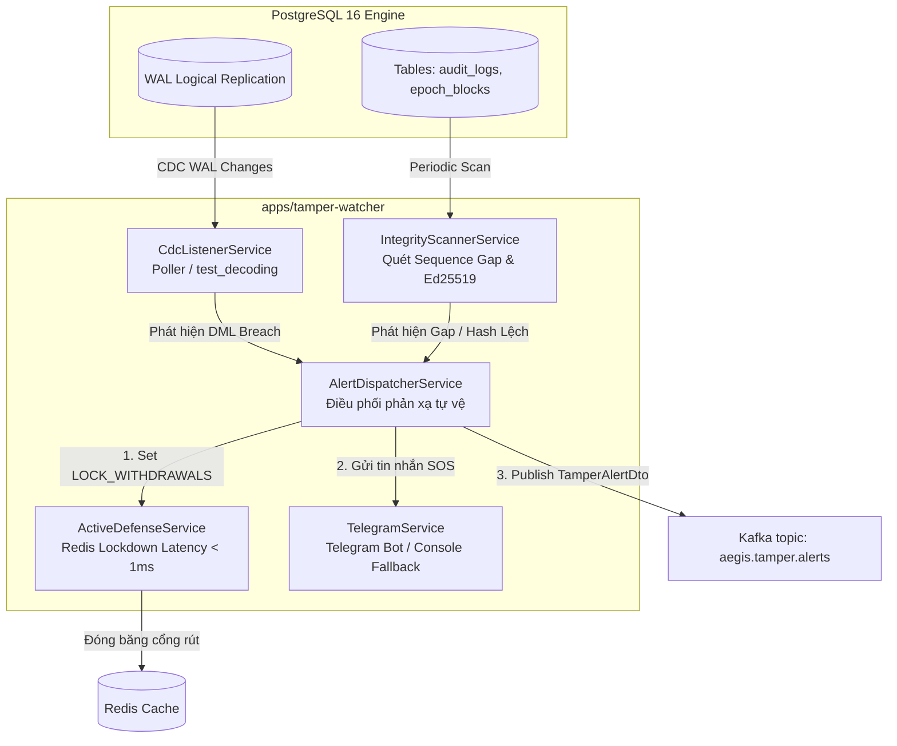

# Tamper Watcher (`apps/tamper-watcher`)

Hệ thống Thanh tra Độc lập & Tự vệ Chủ động (Autonomous Active Defense System) hoạt động ngầm (daemon) trong hệ sinh thái **Aegis Ledger**.

---

## 1. Ý nghĩa & Vai trò trong Kiến trúc Aegis Ledger

Trong kịch bản Hacker hoặc Quản trị viên cơ sở dữ liệu biến chất (Rogue DBA) dùng quyền tối cao (`postgres` superuser) để:
- Tắt trigger WORM (`ALTER TABLE ... DISABLE TRIGGER ALL;`)
- Chạy lệnh SQL sửa lén số dư, thay đổi ví nhận hoặc xoá log cũ nhằm tẩu tán tài sản.

**`tamper-watcher` đóng vai trò là "Cảnh sát Phản ứng Nhanh":**
1. **Bắt quả tang ở tầng sâu nhất (PostgreSQL WAL via Logical Replication CDC):**
   Mọi thao tác ghi đĩa đều sinh nhật ký Write-Ahead Log (WAL). Watcher gắn vào replication slot đọc luồng CDC để phát hiện can thiệp ngay tức thì.
2. **Kích hoạt Phòng vệ Tự động trong $< 200\text{ms}$ (Active Defense):**
   Ngay khi phát hiện lệnh `UPDATE` hoặc `DELETE` trên bảng Append-Only, Watcher bật cờ đỏ khẩn cấp trên Redis:
   ```
   AEGIS:ACTIVE_DEFENSE:LOCK_WITHDRAWALS = "true"
   ```
   Dịch vụ `wallet-core` sẽ lập tức chặn đứng mọi giao dịch rút tiền (`POST /wallets/withdraw`) và chuyển tiền (`POST /wallets/transfer`) với mã lỗi **HTTP 423 Locked**.
3. **Phát chuông báo động đa kênh:**
   - Bắn sự kiện `TamperAlertDto` vào Kafka topic `aegis.tamper.alerts`.
   - Bắn tin nhắn SOS khẩn cấp tới **Telegram Bot** của Đội ngũ Bảo mật / SRE.

---

## 2. Kiến trúc & Các Phân hệ Cốt lõi



### Các phân hệ chính:
- **`src/cdc/`:** Lắng nghe replication slot `aegis_tamper_watcher_slot`, phân tích cú pháp câu lệnh DML (`CdcEventParser`), tóm sống `UPDATE` / `DELETE` trái phép.
- **`src/scanner/`:** Quét định kỳ chuỗi sequence liên tục ($1, 2, 3 \dots$), đối chiếu `previous_epoch_root` với `merkle_root` trước đó, và kiểm tra chữ ký số Ed25519 bằng public key.
- **`src/defense/`:** Ghi cờ `AEGIS:ACTIVE_DEFENSE:LOCK_WITHDRAWALS="true"` lên Redis với độ trễ đo lường thực tế $< 1\text{ms}$.
- **`src/alert/`:**
  - `telegram.service.ts`: Định dạng HTML gửi tới Telegram Bot API. Có cơ chế **Console Fallback Mode** tự động nếu chưa cấu hình `TELEGRAM_BOT_TOKEN` / `TELEGRAM_CHAT_ID`.
  - `alert-dispatcher.service.ts`: Điều phối tuần tự: Khóa Redis $\rightarrow$ Bắn Kafka $\rightarrow$ Gửi Telegram.

---

## 3. Cấu hình Môi trường (.env)

| Biến môi trường | Mặc định | Ý nghĩa |
| :--- | :--- | :--- |
| `POSTGRES_HOST` | `localhost` | Địa chỉ PostgreSQL |
| `POSTGRES_PORT` | `5432` | Cổng PostgreSQL |
| `POSTGRES_USER` | `aegis_admin` | Tài khoản kết nối |
| `POSTGRES_PASSWORD` | `aegis_secure_password_2026` | Mật khẩu DB |
| `POSTGRES_DB` | `aegis_ledger_db` | Tên Database |
| `REPLICATION_SLOT_NAME` | `aegis_tamper_watcher_slot` | Tên logical replication slot |
| `REDIS_HOST` | `localhost` | Địa chỉ Redis |
| `REDIS_PORT` | `6379` | Cổng Redis |
| `ACTIVE_DEFENSE_LOCK_KEY` | `AEGIS:ACTIVE_DEFENSE:LOCK_WITHDRAWALS` | Key cờ đỏ tự vệ trên Redis |
| `KAFKA_BROKERS` | `localhost:9092` | Danh sách Kafka broker |
| `TELEGRAM_BOT_TOKEN` | *Tùy chọn* | Token Bot Telegram từ @BotFather |
| `TELEGRAM_CHAT_ID` | *Tùy chọn* | Chat ID nhận tin cảnh báo đỏ |

> **Ghi chú về Telegram:** Nếu để trống `TELEGRAM_BOT_TOKEN` và `TELEGRAM_CHAT_ID`, hệ thống sẽ kích hoạt **Console Fallback Mode** in cảnh báo màu đỏ trực tiếp ra terminal mà không phát sinh lỗi.

---

## 4. Hướng dẫn Kiểm thử & Chạy

### Chạy Unit & E2E Tests:
```bash
npm run test:tamper-watcher
```

### Chạy Daemon Watcher:
```bash
npx nx serve tamper-watcher
```
