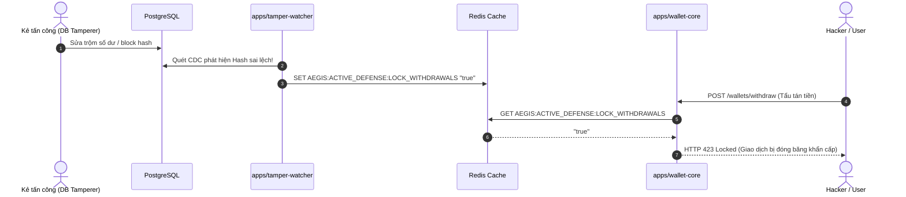

# Wallet Core (`apps/wallet-core`)

Dịch vụ mô phỏng tài chính (Mock Financial Service) đóng vai trò là ứng dụng nguồn (Source Application) trong hệ sinh thái **Aegis Ledger**.

---

## 1. Ý nghĩa & Vai trò trong Kiến trúc Aegis Ledger

`wallet-core` đóng 2 vai trò cốt lõi:
1. **Source of Audit Events (Nguồn phát sinh sự kiện kiểm toán):**
   Mô phỏng các hoạt động thực tế của người dùng ngân hàng/ví điện tử: Đăng nhập (`USER_LOGIN`), Đăng xuất (`USER_LOGOUT`), Nạp tiền (`WALLET_DEPOSIT`), Rút tiền (`WALLET_WITHDRAW`), và Chuyển khoản (`WALLET_TRANSFER`).
   Mỗi hành động đều được chuyển hóa thành `AuditEventDto` chuẩn hóa và phát tán vào Kafka topic `aegis.audit.events` để ứng dụng `audit-ledger` ghi nhận và đóng gói vào Merkle Tree & Hash Chain.

2. **Active Defense Intercept Point (Điểm thực thi phòng vệ chủ động):**
   Khi `tamper-watcher` phát hiện hành vi tấn công sửa đổi trực tiếp cơ sở dữ liệu (`audit_blocks` / `audit_events`), nó sẽ bật cờ đỏ khẩn cấp trên Redis:
   ```
   AEGIS:ACTIVE_DEFENSE:LOCK_WITHDRAWALS = "true"
   ```
   `wallet-core` sử dụng `ActiveDefenseGuard` để chặn đứng toàn bộ các giao dịch rút tiền (`POST /wallets/withdraw`) và chuyển khoản (`POST /wallets/transfer`) với mã lỗi **HTTP 423 Locked**, bảo vệ tối đa dòng tiền của hệ thống trước khi kẻ tấn công kịp tẩu tán tài sản.

---

## 2. Kiến trúc & Công nghệ sử dụng

- **Framework:** NestJS (Fastify adapter)
- **Message Broker:** KafkaJS (`@aegis/event-bus`), topic `aegis.audit.events`
- **In-Memory Ledger Store:** `WalletStore` với tính năng mô phỏng tài khoản, giao dịch và quản lý số dư tức thời.
- **Active Defense:** `ioredis` kết nối Redis để tra cứu trạng thái khóa khẩn cấp với độ trễ thấp (< 1ms).
- **Validation & Transformation:** `class-validator`, `class-transformer` đảm bảo kiểm soát chặt chẽ dữ liệu đầu vào.
- **Client Metadata Decorator:** `@ClientInfo()` tự động trích xuất `ipAddress`, `userAgent`, và `deviceId` từ Request Header (`x-device-id`, `x-forwarded-for`).

---

## 3. Danh sách Endpoint API

### 3.1. Authentication (`/auth`)

| Phương thức | Endpoint | Mô tả | Audit Action tương ứng |
| :--- | :--- | :--- | :--- |
| `POST` | `/auth/login` | Xác thực đăng nhập (username / password) | `USER_LOGIN_SUCCESS` / `USER_LOGIN_FAILED` |
| `POST` | `/auth/logout` | Đăng xuất phiên làm việc | `USER_LOGOUT` |

**Payload Đăng nhập:**
```json
{
  "username": "alice",
  "password": "password123"
}
```

---

### 3.2. Wallets (`/wallets`)

| Phương thức | Endpoint | Bảo vệ Active Defense | Mô tả | Audit Action |
| :--- | :--- | :---: | :--- | :--- |
| `POST` | `/wallets` | Không | Khởi tạo ví mới | - |
| `GET` | `/wallets/:id` | Không | Tra cứu thông tin và số dư ví | - |
| `POST` | `/wallets/deposit` | Không | Nạp tiền vào ví | `WALLET_DEPOSIT` |
| `POST` | `/wallets/withdraw` | **CÓ (423 Locked)** | Rút tiền khỏi ví | `WALLET_WITHDRAW` |
| `POST` | `/wallets/transfer` | **CÓ (423 Locked)** | Chuyển khoản giữa 2 ví | `WALLET_TRANSFER` |
| `GET` | `/wallets/:id/history` | Không | Xem lịch sử giao dịch của ví | - |

**Payload Rút tiền (`POST /wallets/withdraw`):**
```json
{
  "walletId": "wal_alice_usd",
  "amount": 100
}
```

**Payload Chuyển tiền (`POST /wallets/transfer`):**
```json
{
  "fromWalletId": "wal_alice_usd",
  "toWalletId": "wal_bob_usd",
  "amount": 50
}
```

---

## 4. Cơ chế Active Defense (Tự vệ chủ động)



---

## 5. Hướng dẫn Chạy & Kiểm thử

### Chạy Unit & E2E Tests:
```bash
npm run test:wallet-core
```

### Chạy ứng dụng độc lập:
```bash
npx nx serve wallet-core
```
Cổng mặc định: `http://localhost:3000`
