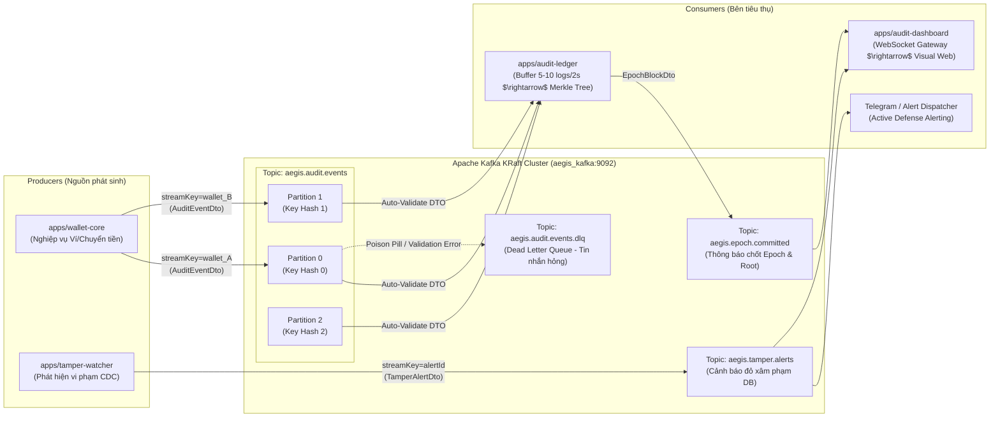

# 📋 Kế Hoạch Triển Khai `@aegis/event-bus` (Implementation Plan)

> **Mã thư viện:** `@aegis/event-bus`  
> **Vị trí:** `libs/event-bus/`  
> **Mục tiêu:** Xây dựng Message Streaming & Event Ingestion Layer phân tán dựa trên Apache Kafka (KRaft mode), cung cấp Producer/Consumer wrappers type-safe, bảo toàn thứ tự giao dịch (Partition Ordering via Stream Key), tự động validate DTO và chống treo hệ thống với Dead Letter Queue (DLQ).  
> **Công nghệ chính:** **KafkaJS** + Apache Kafka 3.7 (KRaft) + NestJS + `class-validator` / `class-transformer` + `@aegis/contracts`  
> **Trạng thái:** ✅ **Đã hoàn thành triển khai 100% (8/8 tests passed)**

---

## 🎯 1. Mục Tiêu & Phạm Vi Triển Khai (Objectives & Scope)

Theo lộ trình kiến trúc tại [ROADMAP.md](../../ROADMAP.md) (**Bước 5 / Phase 3**), `@aegis/event-bus` đóng vai trò là "hệ tuần hoàn thông tin" kết nối các microservices độc lập trong hệ sinh thái AegisLedger:

1. **Phi đồng bộ hóa (Asynchronous Decoupling):**
   - Tách rời hoàn toàn dịch vụ nghiệp vụ tài chính (`apps/wallet-core`) khỏi cỗ máy kiểm toán băm cây Merkle (`apps/audit-ledger`).
   - Đảm bảo khi lưu lượng giao dịch tăng đột biến (traffic spike), `wallet-core` vẫn phản hồi nhanh chóng (sub-millisecond) bằng cách bắn event vào Kafka topic thay vì chờ tính toán Merkle Tree và ghi đĩa PostgreSQL.
2. **Bảo toàn thứ tự tuyệt đối theo thực thể (Strict Ordering per Entity via Stream Key):**
   - Mật mã học không chấp nhận việc đảo lộn thứ tự thời gian của các giao dịch trên cùng một tài khoản (ví dụ: giao dịch Rút tiền không thể xảy ra trước giao dịch Nạp tiền).
   - Producer bắt buộc phải ánh xạ `streamKey` (ví dụ `walletId` hoặc `userId`) làm Kafka Message Key để đảm bảo toàn bộ sự kiện của cùng một thực thể luôn được phân phối vào **cùng một Partition** theo thứ tự FIFO (First-In, First-Out).
3. **Tự động Deserialize & Type-Safe Validation:**
   - Consumer tự động parse chuỗi JSON, hydrate thành Class DTO tương ứng của [`libs/contracts`](../contracts/README.md) và chạy kiểm tra tính hợp lệ bằng `class-validator`.
   - Ngăn chặn triệt để dữ liệu rác, thiếu trường hoặc sai kiểu lọt vào cỗ máy tính toán băm SHA-256 Canonical JSON.
4. **Phòng chống Treo Hệ Thống (Poison Pill Protection & Dead Letter Queue - DLQ):**
   - Khi gặp tin nhắn lỗi syntax hoặc vi phạm validation DTO (Poison Pill), consumer không được phép crash lặp đi lặp lại khiến luồng xử lý partition bị tắc nghẽn (Blockade).
   - Cơ chế tự động bắt ngoại lệ, ghi log cảnh báo và định tuyến tin nhắn lỗi sang topic Dead Letter Queue (`aegis.audit.events.dlq`), sau đó commit offset an toàn để tiếp tục đón nhận các sự kiện tiếp theo.
5. **Tích hợp Tự nhiên với NestJS (Idiomatic NestJS Module):**
   - Đóng gói dưới dạng Dynamic Module (`EventBusModule.forRoot()`, `forRootAsync()`), hỗ trợ Dependency Injection cho mọi microservice trong monorepo.

---

## 🏗️ 2. Kiến Trúc & Thiết Kế Module

### 2.1. Sơ đồ Luồng Dữ liệu Tổng Thể (System Event Flow)



### 2.2. Danh Sách Topic & Consumer Group Tiêu Chuẩn

| Tên Topic | Partition | Key Định Tuyến | Mục Đích & Nội Dung | Producer | Consumer |
| :--- | :---: | :--- | :--- | :--- | :--- |
| `aegis.audit.events` | 3 | `streamKey` (vd: `wal_123`) | Dòng sự kiện kiểm toán nghiệp vụ (`AuditEventDto`) | `wallet-core`, services khác | `audit-ledger` |
| `aegis.tamper.alerts` | 1 | `alertId` / `targetTable` | Cảnh báo vi phạm tính bất biến phát hiện qua CDC (`TamperAlertDto`) | `tamper-watcher` | `audit-dashboard`, Alerting |
| `aegis.epoch.committed` | 1 | `epochNumber` | Thông báo Epoch mới chốt sổ kèm Merkle Root & Chữ ký số | `audit-ledger` | `audit-dashboard`, external archiver |
| `aegis.audit.events.dlq` | 1 | `originalEventId` | Hàng đợi lưu tin nhắn hỏng/sai schema để kiểm tra hậu kỳ | `event-bus` (Consumer DLQ handler) | SRE / Ops inspection |

---

## 🧩 3. Cấu Trúc Thư Mục & Phân Tách Trách Nhiệm (`libs/event-bus/src/`)

```text
libs/event-bus/
├── project.json
├── tsconfig.lib.json
├── jest.config.js
├── README.md                           # Tài liệu chuyên sâu về kiến trúc, events, payload
├── PLAN.md                             # Bản kế hoạch triển khai (file này)
└── src/
    ├── index.ts                        # Barrel export toàn bộ public API
    ├── constants/
    │   ├── topics.constant.ts          # Khai báo Topic names & DLQ topics
    │   ├── groups.constant.ts          # Khai báo Consumer Group IDs chuẩn
    │   └── headers.constant.ts         # Khai báo các Header chuẩn (x-correlation-id, x-event-type...)
    ├── interfaces/
    │   ├── event-bus-options.interface.ts # Cấu hình Kafka Client (brokers, clientId, ssl, retry)
    │   ├── message-context.interface.ts   # Context truyền vào Consumer Handler (topic, partition, offset, headers)
    │   └── consumer-handler.interface.ts  # Typed Consumer Callback handler
    ├── services/
    │   ├── kafka-client.factory.ts     # Khởi tạo singleton Kafka instance và quản lý lifecycle
    │   ├── kafka-producer.service.ts   # Wrapper gửi message, streamKey routing, distributed tracing headers
    │   └── kafka-consumer.service.ts   # Wrapper subscribe, auto-validation qua DTO, DLQ routing, offset management
    ├── modules/
    │   └── event-bus.module.ts         # Dynamic Module NestJS (forRoot, forRootAsync)
    └── __tests__/
        ├── kafka-producer.service.spec.ts # Unit tests Producer (Mock KafkaJS)
        ├── kafka-consumer.service.spec.ts # Unit tests Consumer & DTO Validation
        └── dlq-routing.spec.ts            # Unit tests cơ chế cách ly tin nhắn độc hại (Poison Pill)
```

---

## 🛠️ 4. Thiết Kế Chi Tiết Từng Thành Phần Cốt Lõi

### 4.1. Cấu Hình & Dynamic Module (`EventBusModule`)

Hỗ trợ khai báo linh hoạt qua biến môi trường hoặc Factory Pattern trong NestJS:

```typescript
@Module({})
export class EventBusModule {
  static forRoot(options: KafkaConfigOptions): DynamicModule;
  static forRootAsync(options: KafkaConfigAsyncOptions): DynamicModule;
}
```

Tham số cấu hình bao gồm:
* `brokers`: Danh sách Kafka brokers (mặc định: `['localhost:9092']`).
* `clientId`: Định danh client trong Kafka cluster (ví dụ: `aegis-wallet-producer`, `aegis-ledger-consumer`).
* `retry`: Số lần retry khi mất kết nối (`retries: 5`, `initialRetryTime: 300ms`).
* `dlqEnabled`: Bật/tắt tự động chuyển hướng message lỗi sang topic DLQ.

### 4.2. `KafkaProducerService` (Type-Safe & Stream-Key Partitioning)

* **Phương thức chuyên biệt:** `publishAuditEvent(event: AuditEventDto): Promise<RecordMetadata>`
  * Tự động lấy `event.streamKey` làm Kafka Message Key.
  * Tự động gắn các Headers chuẩn:
    * `x-correlation-id`: UUID truy vết chuỗi hành động.
    * `x-event-type`: `AuditEventDto`.
    * `x-source-service`: Tên service gửi.
    * `x-sent-at`: Timestamp ISO 8601.
* **Phương thức tổng quát:** `publish<T>(topic: string, key: string, payload: T, headers?: Record<string, string>): Promise<RecordMetadata>`
* **Cơ chế Idempotence:** Cấu hình `idempotent: true` trên KafkaJS Producer để broker loại trừ tin nhắn trùng lặp do mạng gián đoạn (Network Retries).

### 4.3. `KafkaConsumerService` (Auto-Validation & DLQ Protection)

* **Phương thức:**
  ```typescript
  async subscribe<T extends object>(options: {
    topic: string;
    groupId: string;
    dtoClass: ClassConstructor<T>;
    handler: (data: T, context: IMessageContext) => Promise<void>;
    fromBeginning?: boolean;
  }): Promise<void>;
  ```
* **Quy trình xử lý một Message đến:**
  1. **Parse JSON:** Đọc `message.value` (Buffer) sang JavaScript Object.
  2. **Hydrate & Validate:** Sử dụng `plainToInstance(dtoClass, parsedJson)` và `validateOrReject(instance)`.
  3. **Nếu DTO hợp lệ:** Chuyển giao đối tượng type-safe cho hàm `handler(data, context)` xử lý nghiệp vụ (ví dụ đẩy vào Sliding Window của `audit-ledger`).
  4. **Nếu DTO không hợp lệ / JSON hỏng (Poison Pill):**
     * Không ném lỗi làm crash tiến trình Node.js!
     * Đóng gói thông tin lỗi (`validationErrors`, `rawPayload`, `originalHeaders`) và gửi sang `[topic].dlq`.
     * Cho phép consumer commit offset của message lỗi để partition tiếp tục tiến trình bình thường.

---

## 📅 5. Lộ Trình Triển Khai Chi Tiết (Step-by-Step Execution Plan)

### Giai đoạn 1: Cài đặt Dependency & Cấu hình Hạ tầng Workspace (Setup Phase)
- [x] Bổ sung thư viện `kafkajs` vào `package.json`.
- [x] Cấu hình các script kiểm thử `test:event-bus` trong `package.json`.
- [x] Kiểm tra tính sẵn sàng của Kafka KRaft container (`docker compose -f tools/docker/docker-compose.kafka.yml ps`).

### Giai đoạn 2: Định nghĩa Hằng số & Giao diện (Constants & Interfaces)
- [x] Khởi tạo `src/constants/topics.constant.ts` (Topic names, DLQ naming strategy).
- [x] Khởi tạo `src/constants/groups.constant.ts` (Consumer Group IDs).
- [x] Khởi tạo `src/constants/headers.constant.ts` (Standard Kafka Headers).
- [x] Khởi tạo `src/interfaces/event-bus-options.interface.ts`.
- [x] Khởi tạo `src/interfaces/message-context.interface.ts`.

### Giai đoạn 3: Hiện thực Tầng Producer (`KafkaProducerService`)
- [x] Xây dựng `KafkaClientFactory` quản lý Singleton Kafka Instance, Graceful Connect/Disconnect.
- [x] Xây dựng `KafkaProducerService` với cơ chế Idempotent Producer.
- [x] Cài đặt logic gán `streamKey` làm Partition Key và tự động đính kèm Distributed Tracing Headers.
- [x] Viết Unit Test cho `KafkaProducerService` (Mock KafkaJS Producer).

### Giai đoạn 4: Hiện thực Tầng Consumer & Phòng chống Lỗi (`KafkaConsumerService`)
- [x] Xây dựng `KafkaConsumerService` quản lý Consumer Groups.
- [x] Hiện thực Pipeline: `Buffer $\rightarrow$ JSON.parse $\rightarrow$ plainToInstance $\rightarrow$ validateOrReject`.
- [x] Xây dựng cơ chế bắt lỗi Poison Pill và tự động đẩy sang Topic Dead Letter Queue (`.dlq`).
- [x] Viết Unit Test cho `KafkaConsumerService` (Kiểm thử cả trường hợp dữ liệu chuẩn và dữ liệu cố tình sai schema).

### Giai đoạn 5: Đóng gói Dynamic Module & Xuất Public API
- [x] Xây dựng `EventBusModule` hỗ trợ `forRoot` và `forRootAsync` cho NestJS.
- [x] Đăng ký `index.ts` xuất toàn bộ Services, Modules, Interfaces, Constants.
- [x] Cập nhật `tsconfig.base.json` (đã có đường dẫn `@aegis/event-bus`).
- [x] Chạy kiểm thử tự động toàn diện (`npm run test:event-bus` đạt 8/8 tests passed).

---

## 🧪 6. Tiêu Chí Nghiệm Thu (Acceptance Criteria)

1. **Coverage & Unit Testing:**
   - Đạt 100% passed cho bộ test suites (`jest libs/event-bus`).
   - Kiểm thử đầy đủ các kịch bản:
     * Producer gửi message kèm đúng `streamKey` và headers.
     * Consumer parse thành công `AuditEventDto` và `TamperAlertDto`.
     * Consumer phát hiện tin nhắn thiếu trường (`eventId`, `actor`...) và kích hoạt DLQ routing mà không bị crash luồng.
2. **Tuân thủ Chuẩn Monorepo:**
   - Type-safe 100% với `@aegis/contracts`. Không sử dụng kiểu `any` tùy tiện trong các public methods.
   - Hỗ trợ Graceful Shutdown (`onModuleDestroy`) đóng sạch kết nối Kafka socket khi ứng dụng tắt.
3. **Sẵn sàng Ghép nối Microservices:**
   - `apps/audit-ledger` có thể inject `KafkaConsumerService` để tiêu thụ dữ liệu vào Sliding Window.
   - `apps/wallet-core` có thể inject `KafkaProducerService` để bắn sự kiện giao dịch.

---

*Tài liệu này là chuẩn thiết kế kỹ thuật chính thức cho module `libs/event-bus` thuộc dự án AegisLedger.*
