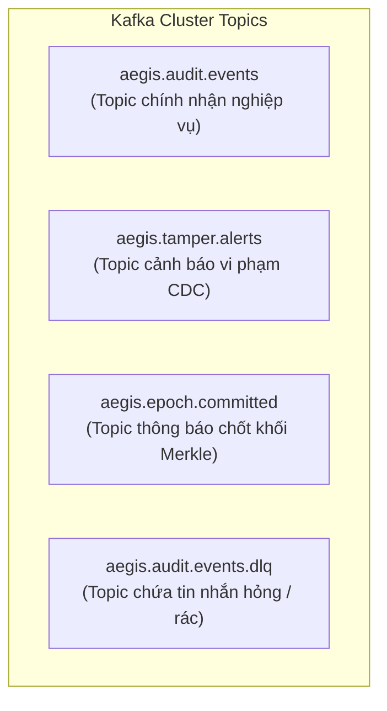
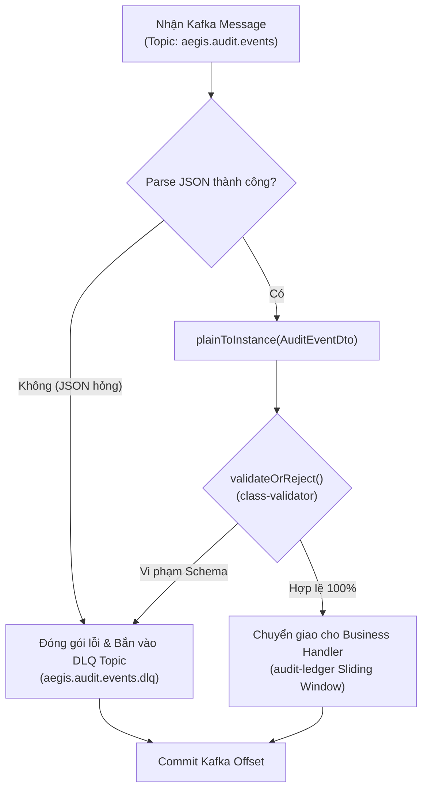

# 📬 `@aegis/event-bus` - Distributed Message Streaming & Event Ingestion Layer

> **Vị trí:** `libs/event-bus/`  
> **Kiến trúc:** Event-Driven Architecture (EDA), Apache Kafka 3.7 (KRaft mode), KafkaJS, NestJS Dynamic Module  
> **Vai trò:** Tầng Giao tiếp & Truyền dẫn Thông điệp Phân tán (Message Bus) chịu trách nhiệm vận chuyển dòng sự kiện kiểm toán, bảo toàn thứ tự giao dịch tuyệt đối theo thực thể qua cơ chế phân vùng Partition bằng `streamKey`, tự động thẩm định dữ liệu đầu vào (DTO Validation) và cách ly tin nhắn lỗi với Dead Letter Queue (DLQ).

---

## 🧭 1. Ý Nghĩa & Sứ Mệnh Cốt Lõi (Mission & Significance)

Trong một hệ sinh thái kiểm toán mật mã và bảo mật cấp cao như **AegisLedger**, việc truyền dẫn dữ liệu giữa các dịch vụ không thể sử dụng các cuộc gọi HTTP REST hay gRPC đồng bộ truyền thống. `@aegis/event-bus` ra đời để giải quyết 4 thách thức nền tảng:

```text
┌─────────────────────────┐                                 ┌─────────────────────────┐
│     apps/wallet-core    │                                 │    apps/audit-ledger    │
│   (Giao dịch Tài chính) │                                 │  (Tính toán Merkle Tree)│
└────────────┬────────────┘                                 └────────────▲────────────┘
             │                                                           │
             │ 1. Bắn sự kiện kèm streamKey                              │ 4. Tiêu thụ theo lô
             ▼                                                           │    (Sliding Window)
   ┌─────────────────────────────────────────────────────────────────────┴────────┐
   │                    @aegis/event-bus (Apache Kafka Cluster)                   │
   │                                                                              │
   │   Partition 0 [wal_001: Tx1, Tx2, Tx3...] ──► FIFO STRICT ORDERING           │
   │   Partition 1 [wal_002: TxA, TxB...]                                         │
   │   Partition 2 [wal_003: TxX, TxY...]                                         │
   │                                                                              │
   │   Dead Letter Queue [Poison Pill / Invalid JSON] ──► CHỐNG TREO HỆ THỐNG     │
   └──────────────────────────────────────────────────────────────────────────────┘
```

### 1.1. Phi đồng bộ hóa hoàn toàn (Asynchronous Decoupling)
Dịch vụ tài chính (`apps/wallet-core`) cần hoàn tất thao tác nạp/chuyển tiền cho người dùng trong thời gian tính bằng mili-giây ($< 10\text{ms}$). Trong khi đó, việc gom log, sắp xếp chuẩn hóa Canonical JSON, tính toán băm cây Merkle Tree $O(\log N)$, ký số mật mã học Ed25519 và ghi đĩa WORM trên PostgreSQL tại `apps/audit-ledger` là tác vụ tiêu tốn CPU và I/O.
Nhờ có Message Bus, `wallet-core` chỉ việc phát ra một sự kiện kiểm toán (`AuditEvent`) và kết thúc phiên làm việc, không cần bận tâm cỗ máy kiểm toán đang xử lý ở đâu.

### 1.2. Bảo toàn thứ tự tuyệt đối theo thực thể (Strict Ordering via Stream Key)
> **Quy luật bất biến trong Mật mã & Kế toán:**  
> Một tài khoản không bao giờ được phép ghi nhận hành động *Rút tiền* xảy ra **trước** hành động *Nạp tiền*.

Nếu gửi qua HTTP REST đa luồng, do độ trễ mạng khác nhau, request Nạp tiền có thể đến sau request Rút tiền $\rightarrow$ chuỗi Log băm Merkle sẽ bị đảo lộn, số dư âm giả mạo, làm sụp đổ tính toàn vẹn của bằng chứng kiểm toán.  
Kafka giải quyết vấn đề này bằng cơ chế **Partition Hash Ring**: Mọi message có cùng **Message Key** (`streamKey` = `walletId`) sẽ luôn luôn được đưa vào **cùng một Partition duy nhất**, đảm bảo thứ tự đọc ra tuân thủ nghiêm ngặt nguyên lý **FIFO (First-In, First-Out)**.

### 1.3. Đệm tải & Làm mịn lưu lượng (Backpressure & Buffer Smoothing)
Khi có sự kiện siêu khuyến mãi hoặc bị tấn công từ chối dịch vụ (DDoS), hàng triệu giao dịch có thể phát sinh trong vài giây. Message Bus hoạt động như một hồ chứa đệm (Buffer Pool), hấp thụ toàn bộ xung nhịp áp lực này. Cỗ máy `apps/audit-ledger` ở phía sau sẽ bình thản kéo dữ liệu theo đúng năng lực xử lý (Sliding Window: 5–10 logs hoặc 2 giây) mà không bao giờ bị nghẽn đĩa hay sập bộ nhớ (OOM).

### 1.4. Tự phục hồi & Tính sẵn sàng cao (Fault Tolerance & At-least-once Delivery)
Nếu cỗ máy `audit-ledger` cần khởi động lại hoặc cập nhật phiên bản mới, các tin nhắn trong Kafka vẫn được lưu trữ an toàn trên đĩa cứng (Persistence Stream). Khi `audit-ledger` sống lại, nó tiếp tục đọc từ đúng vị trí con trỏ (Offset) chưa commit, đảm bảo **không một bản ghi kiểm toán nào bị biến mất**.

---

## ⚡ 2. Các Chức Năng Nòng Cốt (Key Features)

1. **Trừu tượng hóa KafkaJS Chuẩn mực:** Che giấu toàn bộ cấu hình mạng, SSL, SASL, heartbeat và rebalance phức tạp của Kafka sau các phương thức tiện ích đơn giản.
2. **Type-Safe Producer với Stream-Key Routing:** Tự động trích xuất `streamKey` làm Partition Key, tự động gán nhãn Correlation ID và Distributed Tracing Headers.
3. **Consumer Tự Động Deserialize & Validate DTO:** Tích hợp trực tiếp với bộ hợp đồng [`@aegis/contracts`](../contracts/README.md). Tự động dùng `class-transformer` chuyển chuỗi byte sang DTO và `class-validator` để kiểm định trường bắt buộc trước khi bàn giao cho tầng nghiệp vụ.
4. **Cơ Chế Cách Ly Tin Nhắn Độc Hại (Poison Pill Protection & DLQ):** Tự động phát hiện các message dị tật (sai cú pháp JSON, thiếu trường quan trọng) và chuyển hướng an toàn sang topic `.dlq`, ngăn chặn tình trạng Consumer bị crash lặp vô tận (Crash Loop Backoff).
5. **Cấu hình Đảm bảo Đơn nhất (Idempotent Producer):** Kích hoạt `idempotent: true` để tránh trùng lặp bản ghi khi xảy ra hiện tượng mất gói tin mạng và retry giữa Producer và Broker.
6. **NestJS Native Dynamic Module:** Hỗ trợ `EventBusModule.forRoot()` và `EventBusModule.forRootAsync()`, dễ dàng inject vào bất kỳ Controller, Service hay Consumer nào trong NestJS.

---

## 📬 3. Kiến Trúc Thông Điệp, Topics & Ý Nghĩa Chi Tiết Từng Payload

### 3.1. Cấu Trúc Tổng Thể Của Một Kafka Message Trong AegisLedger

Mỗi bản tin được truyền qua `@aegis/event-bus` đều mang cấu trúc chuẩn 4 phần:

```text
┌────────────────────────────────────────────────────────────────────────┐
│ KAFKA MESSAGE ENVELOPE                                                 │
├────────────────────────────────────────────────────────────────────────┤
│ 1. KEY:       "wal_99882233" (streamKey dùng để băm chọn Partition)    │
│ 2. HEADERS:   x-correlation-id: "f3a2c1b0-9988-..."                    │
│               x-event-type:     "AuditEventDto"                        │
│               x-source-service: "wallet-core"                          │
│               x-sent-at:        "2026-10-17T15:00:00.000Z"             │
│ 3. VALUE:     Chuỗi JSON UTF-8 của đối tượng sự kiện nghiệp vụ        │
│ 4. TIMESTAMP: Thời điểm Broker tiếp nhận tin nhắn                      │
└────────────────────────────────────────────────────────────────────────┘
```

---

### 3.2. Danh Sách Topics Tiêu Chuẩn



1. **`aegis.audit.events` (3 Partitions):**  
   - Kênh giao tiếp huyết mạch tiếp nhận mọi hành động từ tất cả dịch vụ trong hệ sinh thái.
   - Số partition mặc định là **3** để mở rộng năng lực xử lý song song (Horizontal Scalability).
2. **`aegis.tamper.alerts` (1 Partition):**  
   - Kênh phát tín hiệu khẩn cấp khi phát hiện cơ sở dữ liệu WORM bị tấn công sửa/xóa trái phép.
3. **`aegis.epoch.committed` (1 Partition):**  
   - Kênh phát thanh thông báo một Epoch mới đã được chốt sổ, tính toán xong Merkle Root và ký số Ed25519.
4. **`aegis.audit.events.dlq` (1 Partition):**  
   - Nơi lưu trữ các tin nhắn hỏng không qua được bộ lọc DTO Validation của Consumer.

---

### 3.3. Giải Mã Chi Tiết Các Trường Trong Payload (Payload Deep Dive)

#### 🅰️ Sự Kiện Kiểm Toán Nghiệp Vụ: `AuditEventDto` (`aegis.audit.events`)

Đây là nguyên liệu đầu vào để sau này cỗ máy `audit-ledger` đưa qua thuật toán **Canonical JSON** $\rightarrow$ **SHA-256** nhằm tạo ra các **Lá Merkle (`leafHash`)**.

```json
{
  "eventId": "evt_7f1c4a2e-8b3d-4e5f-9a1c-0d8e7f6a5b4c",
  "streamKey": "wal_user_9988",
  "timestamp": "2026-10-17T15:04:05.123Z",
  "actor": {
    "userId": "usr_alex_88",
    "role": "CUSTOMER",
    "ipAddress": "198.51.100.42",
    "userAgent": "Mozilla/5.0 (iPhone; CPU iPhone OS 17_0) Mobile"
  },
  "action": "WALLET_TRANSFER",
  "resource": {
    "type": "WALLET",
    "id": "wal_user_9988"
  },
  "payload": {
    "recipientWalletId": "wal_merchant_001",
    "amount": 2500000,
    "currency": "VND",
    "memo": "Thanh toan hoa don dich vu"
  }
}
```

* **Ý nghĩa từng trường:**
  * **`eventId` (String - UUID):** Định danh duy nhất toàn cục cho sự kiện. Dùng để chống trùng lặp (Deduplication) và truy vết lịch sử.
  * **`streamKey` (String):** Khóa định tuyến Kafka. Cực kỳ quan trọng: quy tụ mọi hành động liên quan đến cùng một ví/người dùng vào chung một partition để giữ đúng thứ tự thời gian.
  * **`timestamp` (String - ISO 8601 UTC):** Thời điểm chính xác sự kiện phát sinh tại service nghiệp vụ. Trường này sẽ tham gia trực tiếp vào việc tính mã băm Merkle Leaf.
  * **`actor` (Object):** Danh tính chủ thể thực hiện hành vi.
    * `userId`: Mã định danh người dùng / hệ thống thực hiện thao tác.
    * `role`: Phân quyền tại thời điểm thao tác (`ADMIN`, `CUSTOMER`, `SYSTEM`).
    * `ipAddress`: Địa chỉ IP nguồn (phục vụ giám sát an ninh mạng và vị trí địa lý).
    * `userAgent`: Thiết bị / ứng dụng gửi yêu cầu (phát hiện dấu hiệu bot hoặc phiên đăng nhập lạ).
  * **`action` (String - Enum `AuditAction`):** Hành động được thực thi (ví dụ: `WALLET_DEPOSIT`, `WALLET_TRANSFER`, `USER_LOGIN_FAILED`, `ROLE_ASSIGNED`...).
  * **`resource` (Object):** Đối tượng đích chịu tác động của hành động.
    * `type`: Loại tài nguyên (`WALLET`, `USER`, `ROLE`, `API_KEY`).
    * `id`: Khóa chính của tài nguyên đó.
  * **`payload` (Record<string, any>):** Dữ liệu chi tiết về ngữ cảnh giao dịch (số tiền, người nhận, ghi chú...). Được lưu dạng `JSONB` trong PostgreSQL và chuẩn hóa thứ tự key khi băm SHA-256.

---

#### 🅱️ Sự Kiện Cảnh Báo Vi Phạm: `TamperAlertDto` (`aegis.tamper.alerts`)

Được phát ra bởi dịch vụ `apps/tamper-watcher` khi phát hiện can thiệp trái phép trên cơ sở dữ liệu WORM thông qua PostgreSQL CDC.

```json
{
  "alertId": "alt_c4b3a2-9911-4455-88aa-123456789abc",
  "severity": "CRITICAL",
  "breachType": "UNAUTHORIZED_UPDATE",
  "targetTable": "audit_logs",
  "affectedId": "evt_7f1c4a2e-8b3d-4e5f-9a1c-0d8e7f6a5b4c",
  "detectedAt": "2026-10-17T15:04:05.310Z",
  "message": "Phát hiện lệnh SQL UPDATE sửa đổi trái phép bản ghi audit_logs!",
  "details": {
    "oldLeafHash": "a3b2c1...",
    "newLeafHash": "f8e7d6...",
    "tamperedFields": ["payload.amount", "actor.userId"]
  }
}
```

* **Ý nghĩa từng trường:**
  * **`alertId` (String):** ID cảnh báo duy nhất để theo dõi quy trình ứng cứu sự cố (Incident Response).
  * **`severity` (Enum `AlertSeverity`):** Mức độ nghiêm trọng (`INFO`, `WARNING`, `HIGH`, `CRITICAL`). Với `CRITICAL`, hệ thống tự động kích hoạt cờ Redis `LOCK_WITHDRAWALS=true`.
  * **`breachType` (Enum `BreachType`):** Loại hình tấn công:
    * `UNAUTHORIZED_UPDATE`: Can thiệp lệnh UPDATE sửa nội dung log cũ.
    * `UNAUTHORIZED_DELETE`: Can thiệp lệnh DELETE xóa mất log làm gãy chuỗi số thứ tự.
    * `HISTORICAL_REWRITE`: Kẻ tấn công sửa data và tự tính lại Root nội bộ, bị lệch mốc External Anchor.
    * `SIGNATURE_FORGERY`: Chữ ký số Ed25519 không khớp với Public Key hệ thống.
  * **`targetTable` (String):** Bảng CSDL bị tấn công (`audit_logs`, `epoch_blocks`, `external_anchors`).
  * **`affectedId` (String / Number):** Khóa chính của hàng bị tác động.
  * **`detectedAt` (ISO 8601):** Thời điểm phát hiện vi phạm (thường $< 200\text{ms}$ kể từ khi câu lệnh SQL thực thi).
  * **`message` & `details`:** Nội dung mô tả và bằng chứng sai lệch trước/sau khi bị sửa.

---

#### 🆎 Sự Kiện Thông Báo Chốt Khối: `EpochCommittedEvent` (`aegis.epoch.committed`)

Phát ra bởi `apps/audit-ledger` mỗi khi một cửa sổ trượt (5–10 logs hoặc 2s) được đóng lại thành công, tính xong Merkle Root và ký chữ ký số Ed25519.

```json
{
  "epochNumber": 142,
  "startSequence": 1411,
  "endSequence": 1420,
  "totalLogs": 10,
  "merkleRoot": "4f8a3b2c1d0e9f8a7b6c5d4e3f2a1b0c9d8e7f6a5b4c3d2e1f0a9b8c7d6e5f4a",
  "previousEpochRoot": "9e8d7c6b5a4f3e2d1c0b9a8f7e6d5c4b3a2f1e0d9c8b7a6f5e4d3c2b1a0f9e8d",
  "signature": "3045022100a1b2c3d4e5f6...",
  "signerPublicKey": "ed25519_pub_7a8b9c...",
  "committedAt": "2026-10-17T15:04:07.000Z"
}
```

* **Ý nghĩa:**
  * Thông báo cho Web Dashboard (`apps/audit-dashboard`) vẽ cây Merkle mới lên màn hình hiển thị trực quan.
  * Cung cấp Root Hash và Chữ ký số cho các dịch vụ bên ngoài muốn kiểm toán định kỳ.

---

#### 🚯 Sự Kiện Dead Letter Queue: `PoisonPillEnvelope` (`aegis.audit.events.dlq`)

Khi một thông điệp không thể giải mã hoặc vi phạm validation DTO, nó sẽ được bọc lại và đưa vào DLQ:

```json
{
  "originalTopic": "aegis.audit.events",
  "originalKey": "wal_user_9988",
  "failedAt": "2026-10-17T15:04:05.150Z",
  "errorReason": "Validation failed: property 'actor.ipAddress' should not be empty, property 'timestamp' must be a valid ISO 8601 string",
  "rawPayload": "{\"eventId\":\"123\",\"streamKey\":\"wal_user_9988\",\"timestamp\":\"invalid-time\"}",
  "headers": {
    "x-source-service": "unknown-service"
  }
}
```

---

## 🛡️ 4. Quy Trình Thẩm Định & Xử Lý Tin Nhắn Của Consumer



1. **Bước 1 (Parse JSON):** Đọc chuỗi byte từ Kafka Buffer thành JavaScript Object.
2. **Bước 2 (Hydration):** Ánh xạ đối tượng thuần sang thực thể Class DTO có Decorators kiểm tra.
3. **Bước 3 (Validation):** Chạy `validateOrReject()` theo quy tắc chặt chẽ của `@aegis/contracts`.
4. **Bước 4 (Dispatching hoặc DLQ):**
   - Nếu đạt: Giao cho hàm xử lý nghiệp vụ.
   - Nếu lỗi: Cách ly sang DLQ để không làm sập Consumer, sau đó commit offset để tiếp tục đón nhận tin nhắn tiếp theo.

---

## 💻 5. Hướng Dẫn Sử Dụng & Mẫu Mã Nguồn (Usage Guide)

### 5.1. Khởi tạo Module trong NestJS (`app.module.ts`)

```typescript
import { Module } from '@nestjs/common';
import { EventBusModule } from '@aegis/event-bus';

@Module({
  imports: [
    EventBusModule.forRoot({
      clientId: 'wallet-service',
      brokers: [process.env.KAFKA_BROKER || 'localhost:9092'],
      dlqEnabled: true,
    }),
  ],
})
export class AppModule {}
```

### 5.2. Bắn Sự Kiện Kiểm Toán từ Producer (`wallet.service.ts`)

```typescript
import { Injectable } from '@nestjs/common';
import { KafkaProducerService, TOPIC_AUDIT_EVENTS } from '@aegis/event-bus';
import { AuditEventDto, AuditAction } from '@aegis/contracts';

@Injectable()
export class WalletService {
  constructor(private readonly producer: KafkaProducerService) {}

  async transferMoney(senderWalletId: string, recipientWalletId: string, amount: number) {
    // 1. Thực hiện nghiệp vụ chuyển tiền...

    // 2. Tạo bản tin AuditEvent chuẩn
    const event: AuditEventDto = {
      eventId: crypto.randomUUID(),
      streamKey: senderWalletId, // Định tuyến cùng Partition theo mã ví
      timestamp: new Date().toISOString(),
      action: AuditAction.WALLET_TRANSFER,
      actor: {
        userId: 'usr_123',
        ipAddress: '10.0.0.1',
        userAgent: 'Mobile-App/1.0',
      },
      resource: {
        type: 'WALLET',
        id: senderWalletId,
      },
      payload: {
        recipientWalletId,
        amount,
        currency: 'VND',
      },
    };

    // 3. Bắn vào Event Bus
    await this.producer.publishAuditEvent(event);
  }
}
```

### 5.3. Tiêu Thụ & Tự Động Thẩm Định tại Consumer (`audit-ledger.service.ts`)

```typescript
import { Injectable, OnModuleInit } from '@nestjs/common';
import { KafkaConsumerService, TOPIC_AUDIT_EVENTS, CONSUMER_GROUP_AUDIT_LEDGER } from '@aegis/event-bus';
import { AuditEventDto } from '@aegis/contracts';

@Injectable()
export class AuditLedgerService implements OnModuleInit {
  constructor(private readonly consumer: KafkaConsumerService) {}

  async onModuleInit() {
    await this.consumer.subscribe<AuditEventDto>({
      topic: TOPIC_AUDIT_EVENTS,
      groupId: CONSUMER_GROUP_AUDIT_LEDGER,
      dtoClass: AuditEventDto,
      handler: async (event, context) => {
        // 'event' ở đây đảm bảo 100% type-safe và đã qua validateOrReject
        console.log(`Đã nhận sự kiện hợp lệ từ Partition ${context.partition}, Seq: ${event.eventId}`);
        await this.pushToSlidingWindowBuffer(event);
      },
    });
  }

  private async pushToSlidingWindowBuffer(event: AuditEventDto) {
    // Đẩy vào In-Memory Sliding Window (5-10 logs hoặc 2 giây) để dựng cây Merkle
  }
}
```

---

## 🔒 6. Thực Tiễn Tốt Nhất & Cân Nhắc Vận Hành (Best Practices)

1. **Luôn sử dụng `streamKey` đại diện cho Thực Thể:** Không bao giờ để `streamKey` ngẫu nhiên nếu các sự kiện có liên hệ nghiệp vụ với nhau. Việc đặt `streamKey = walletId` đảm bảo toàn bộ lịch sử biến động của ví đó đi theo đúng một đường ray thẳng tắp không bị nhảy cóc.
2. **Kích hoạt Idempotent Producer:** Đảm bảo `idempotent: true` khi khởi tạo Producer để ngăn chặn mạng chập chờn gửi 2 lần cùng một giao dịch.
3. **Giám sát Topic DLQ:** Hàng đợi `aegis.audit.events.dlq` phải được giám sát bởi hệ thống cảnh báo (Prometheus/Grafana). Bất kỳ tin nhắn nào xuất hiện trong DLQ đều là dấu hiệu của việc có phiên bản ứng dụng cũ gửi sai schema hoặc kẻ xấu đang dò quét API.
4. **Graceful Shutdown:** Khi ứng dụng nhận tín hiệu `SIGTERM` hoặc `SIGINT`, các kết nối Kafka Consumer/Producer phải được ngắt lịch sự (`disconnect()`) để Kafka Cluster tái cân bằng (Rebalance) phân vùng cho các Consumer còn lại mà không làm nghẽn tiến trình.

---

## 📖 7. Đối Chiếu Cú Pháp NestJS Docs & Luồng Phát / Nhận Sự Kiện

Để giải tỏa sự khác biệt giữa cú pháp chuẩn trên trang chủ NestJS (`@EventPattern`, `ClientKafka`) và kiến trúc chuyên sâu trong thư viện này:

### 7.1. Bảng Đối Chiếu Cú Pháp Nhanh

| Hành Động | Cú Pháp NestJS Docs (`@nestjs/microservices`) | Cú Pháp Thư Viện `@aegis/event-bus` |
| :--- | :--- | :--- |
| **Khai báo Module** | `ClientsModule.register([{ transport: Transport.KAFKA, ... }])` | `EventBusModule.forRoot({ brokers: ['...'] })` |
| **Bắn Sự Kiện (EMIT)** | `this.client.emit('topic', { key, value })` | `await this.producer.publishAuditEvent(event)` |
| **Nhận Sự Kiện (CONSUME)**| `@EventPattern('topic')`<br>`handler(@Payload() data, @Ctx() ctx)` | `await this.consumer.subscribe({ topic, dtoClass, handler })` |

### 7.2. Điểm Kích Hoạt Phát (EMIT) & Tiếp Nhận (RECEIVE) Sự Kiện Trong Code

* **📤 Nơi Phát Sự Kiện (EMIT):**  
  * Tầng Nghiệp vụ gọi: `await this.producer.publishAuditEvent(event);`
  * Bên dưới thực thi: `await producer.send({ topic, messages: [{ key: event.streamKey, value, headers }] })` (tại [`kafka-producer.service.ts`](file:///home/thanhlong/Documents/aegis-ledger-workspace/libs/event-bus/src/services/kafka-producer.service.ts#L89)).
* **📥 Nơi Tiếp Nhận Sự Kiện (RECEIVE):**  
  * Tầng Thư viện lắng nghe socket: `await consumer.run({ eachMessage: async ({ message }) => { ... } })` (tại [`kafka-consumer.service.ts`](file:///home/thanhlong/Documents/aegis-ledger-workspace/libs/event-bus/src/services/kafka-consumer.service.ts#L50)).
  * Tầng Nghiệp vụ nhận dữ liệu sạch: `handler: async (event, context) => { ... }` sau khi đã tự động kiểm định DTO qua `validateOrReject()`.

👉 *Để xem giải thích chi tiết từng dòng code về Dynamic Module (`forRoot`, `forRootAsync`), Dependency Injection Tokens (`EVENT_BUS_OPTIONS`) và cách hoạt động của `KafkaClientFactory`, vui lòng đọc tài liệu chuyên sâu tại:*  
🔗 **[EXPLANATION.md — Giải Mã Toàn Diện Cú Pháp NestJS & Kafka Trong Event Bus](./EXPLANATION.md)**

---

*Tài liệu này thuộc quyền sở hữu của dự án AegisLedger. Mọi thay đổi về cấu trúc sự kiện bắt buộc phải cập nhật đồng bộ với `@aegis/contracts`.*
